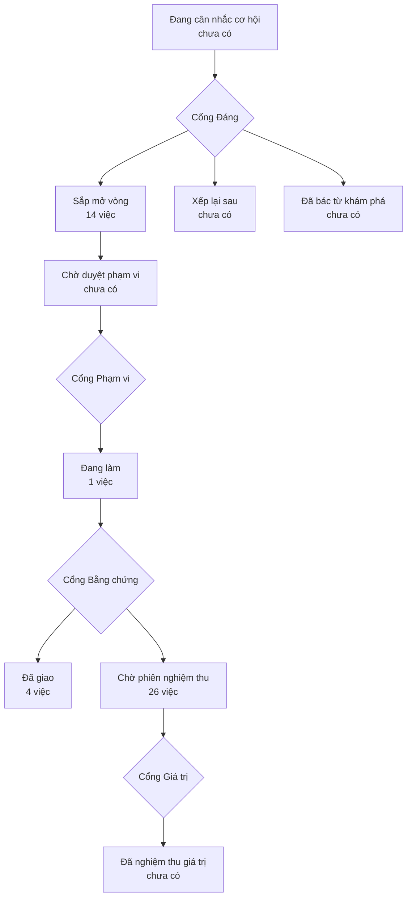

# Bản đồ sản phẩm

> Bản đồ vẽ lại từ hồ sơ của xưởng mỗi lần một người ký một cổng — đừng sửa tay.
> (đọc từ thư mục `_acceptance/` và `.out-of-scope/`)
> Lộ trình: [LO-TRINH.html](LO-TRINH.html)

> **Bốn cổng người** — mỗi cổng là một câu hỏi chỉ người trả lời được:
> **Cổng Đáng** việc này có đáng làm không · **Cổng Phạm vi** bộ tiêu chí
> đã đủ và đúng chưa · **Cổng Bằng chứng** đã làm đúng thứ đã hứa chưa ·
> **Cổng Giá trị** thứ đã giao có ăn thua không.

## Sắp mở vòng

- Đầu chủ kéo hoặc dán ảnh từ Zalo trên máy tính vào hồ sơ căn và xếp vào ba ngăn; ngăn nội bộ không bao giờ ra ngoài, không lưu trên máy (`anh-can-ba-ngan`)
- Đầu chủ che một vùng trên ảnh trước khi gửi; ra ngoài là bản nhẹ, bản gốc giữ lại (`che-vung-anh`)
- Đầu chủ mở chế độ cuộc gọi của một lead trên máy tính: thẻ lead so giá với toà, danh sách hỏi chọn bằng phím, tính giá bao phí ↔ về tay; ghi xong thì mức đủ tự tính lại (`cuoc-goi-khai-thac`)
- Đầu chủ gọi ép giá đợt hai trên máy tính: thấy lịch sử trả giá và giá đáy nội bộ, ghi kết quả bằng phím, hạ giá theo đúng luật sửa giá (`goi-ep-gia-dot-hai`)
- Đầu chủ bấm Gọi trên máy tính thì chế độ cuộc gọi mở và điện thoại của mình quay số chủ nhà (`goi-tu-may-tinh`)
- Đầu chủ mở app vào Hôm nay và thấy các hàng đợi của mình — lead mới, cần gọi lại, nên gọi ép giá, thiếu thông tin, mới đổi — mỗi căn ở đúng một hàng đợi, ghi kết quả gọi một chạm (`hom-nay-dau-chu`)
- Telesales theo dõi lead đã nhập qua bốn nấc Đã gửi → Đã nhận → Đã gọi → Lên bảng, thấy lead bị trả lại kèm «Sửa số và gửi lại»; không thấy hàng (`lead-bon-nac`)
- Gói danh mục Invest đẩy sang theo khuôn phiên bản 1 được nhận vào vùng danh mục dùng chung khi thoả thuận đang bật; gói sai khuôn hay thoả thuận tắt bị từ chối (`nhan-danh-muc-invest`)
- Đầu chủ bấm «Sẵn sàng bán» và căn lên bảng hàng chung ngay khi máy kiểm đủ giá về tay, ảnh thật, pháp lý, tình trạng sử dụng; thiếu thì chỉ đúng chỗ thiếu (`san-sang-ban`)
- Đầu chủ chọn nhiều căn rồi đổi trạng thái, đổi đầu chủ hay đánh dấu đã gọi cho tất cả trong một lần (`sua-hang-loat`)
- Đầu chủ sửa giá, phí, trạng thái ngay trên ô; giá luôn kèm điều kiện phí, máy nói lại «Hiểu là…», sửa là vừa xác nhận với chủ nhà, hoàn tác được (`sua-tren-o`)
- Chủ sản phẩm duyệt Cổng Phạm vi của một vòng chạm ô chưa có khuôn và thấy trang so ba lối — Trong kho, ReUI, Vẽ mới — cùng khổ 1440 và 375, mỗi lối một câu đánh đổi, lời khuyên của máy ghim trên trang; vòng chỉ đi khuôn sẵn thì không có trang ấy (`the-ba-loi`)
- Đầu chủ nhận thông báo lead trên điện thoại và máy tính, chạm vào thì mở đúng mục ở Hôm nay (`thong-bao-lead`)
- Mọi lựa chọn khối của kho có một dòng máy đọc: khối đã chuyển thể ở danh mục giao diện kèm archetype, nhóm đang dùng, ảnh chuẩn, phiên bản ReUI, ngày và người duyệt; chỗ ghép hay tự viết ở «Chỗ hở» kèm điều đã tra trên ReUI, lý do và hạn xem lại — thiếu một ô thì npm run lint đỏ gọi đúng dòng (`vet-chon-khoi`)

## Đang làm

- Đầu chủ chọn một căn và thấy cột hồ sơ cạnh bảng — thuộc tính tự điền, lần rao, lịch sử giá và trạng thái ai sửa khi nào; thấy thuộc tính sai thì bấm «Báo sai thông tin căn» (`cot-ho-so-can`)

## Đã giao — chờ phiên nghiệm thu

- Bộ đồng bộ đưa đúng phần mỗi người được thấy xuống máy, rút mạng năm phút rồi nối lại không mất thay đổi nào (`bai-thu-dong-bo-mat-mang`)
- Lưới bảng hàng 5.000 dòng × 20 cột cuộn, sửa trên ô và dán 500 ô từ Excel mà không giật trên máy tính văn phòng (`bai-thu-luoi-5000-dong`)
- Link trang khách dán vào Zalo hiện ảnh xem trước, và lượt Zalo tự lấy ảnh không bị tính là khách mở (`bai-thu-zalo`)
- Kho có bản đồ khuôn cho các nhóm màn đã có — Cài đặt sàn, Xác thực, trang tạm, trạng thái trống · lỗi · báo — và mỗi nhóm một khuôn có khe mà mọi màn của nhóm dựng qua (`ban-do-khuon-nhom-da-co`)
- Đầu chủ mở Bảng hàng trên máy tính và thấy hàng của sàn dày như Sheet: lọc mọi cột, nhóm theo toà rồi loại căn, lưu góc nhìn (`bang-hang-kieu-sheet`)
- Lệnh chốt bán với ngày bán không có thật (như 30 tháng 2) bị từ chối với lỗi nêu đúng trường ngày bán, không phải lỗi hệ thống (`bao-ro-ngay-ban-sai`)
- Đầu chủ gõ mã căn trùng ở hai toà cùng dự án thì thấy cả hai căn kèm tên toà để chọn, không bị điền lặng lẽ thuộc tính của căn toà khác (`can-trung-ma-hai-toa`)
- Lead không trùng được chia theo luật của sàn trong một phút; quá 15 phút chưa nhận hay 30 phút chưa gọi thì trưởng nhóm được báo (`chia-lead-va-han`)
- Người trong sàn đăng nhập và vào đúng vùng dữ liệu của sàn mình; chưa gắn sàn thì không thấy gì (`dang-nhap-theo-san`)
- Đầu chủ gõ mã căn và thấy thuộc tính căn tự điền theo cách đọc mã của dự án; mã chưa có trong danh mục thì báo rõ (`danh-muc-go-ma-can`)
- Đầu chủ sửa căn lúc máy chủ trục trặc ngắn hay hết phiên thì thay đổi tự gửi lại khi máy chủ trả lời được, chỉ báo đồng bộ nói đúng vì sao chưa gửi, và căn đang ở Cần xem sửa tiếp hay xử lý không kẹt, không đảo thứ tự hai lần sửa (`dong-bo-tu-lanh`)
- Mọi đường gửi mã đăng nhập đi qua cùng giới hạn 5 lần xin mã trong 15 phút cho mỗi email; đường quên mật khẩu của plugin không còn phục vụ (`dong-duong-gui-ma-thua`)
- Bộ dữ liệu mẫu của một sàn thử — một dự án căn hộ, hai mẫu file bảng hàng Excel, lead và chủ nhà giả — sinh từ khuôn của bảng hàng thật, mọi bản ghi mang nhãn mẫu (`du-lieu-mau-san-thu`)
- Lõi, API và tài liệu gọi khu chứa căn là SubdivisionName, mỗi căn mang loại hình PropertyType và PropertySubType theo RESO, và trường dùng được của từng loại hình đọc từ một bảng dữ liệu của lõi (`khu-va-loai-hinh`)
- Mọi thay đổi của hàng đi qua một lệnh API và thành sự kiện chỉ thêm; sáu trạng thái chuẩn, độ tươi và mức đủ thông tin tính ra từ sự kiện (`loi-hang-va-su-kien`)
- Đầu chủ giữ căn thấy chủ nhà, số điện thoại và giá đáy của căn mình; người khác trong sàn mở cùng hồ sơ thì không thấy, và mỗi lần mở số chủ thành một sự kiện (`lop-truong-nguon`)
- Số điện thoại chủ nhà nằm trong cơ sở dữ liệu ở dạng mã hoá; chỉ cửa «Mở số» giải ra số cho người được thấy, đọc thẳng bảng hay bản sao lưu không ra số (`ma-hoa-so-chu`)
- Mở sàn cho công ty mới trùng tên với sàn đang chạy thì được một sàn riêng; người của sàn mới không thấy dữ liệu sàn cũ (`mo-san-trung-ten`)
- Quản trị sàn mời người vào sàn, đặt vai và khu phụ trách; một người giữ được nhiều vai (`moi-nguoi-vai-khu`)
- Bảng hàng và hồ sơ đọc từ kho trên máy nên lọc, cuộn, mở hồ sơ không chờ mạng; sửa ghi trên máy trước, rớt mạng vài phút không mất thay đổi (`nhanh-tuc-thi`)
- Telesales nhập lead đủ năm mục trên máy tính và thấy ngay kết quả kiểm trùng: không trùng, đã có đầu chủ, hay căn đã có hàng mở (`o-nhan-lead`)
- Một màn của nhóm dựng ngoài khuôn làm bài kiểm của kho đỏ và gọi đúng tên tệp cùng khối cấm; chỉ sửa tài liệu hay hồ sơ thì bài kiểm im (`rang-giu-khuon`)
- Kho có bộ chuẩn giao diện trước màn sản phẩm đầu tiên: thành phần ReUI, skill giao diện của kho, lint giao diện có mức nợ, sàn thiết kế M1 (`tang-5-giao-dien`)
- Đầu chủ để lead và hàng chưa khoá nguồn ở «Chỉ tôi»; hàng lên «Toàn sàn» thì cả sàn mới thấy (`truc-ai-thay-hang`)
- Người trong sàn mở Quỹ hàng và thấy đúng vỏ theo thiết bị và vai: trên máy tính thanh trên, cột nhà và cột góc nhìn; trên điện thoại bốn tab dưới; telesales chỉ Hôm nay và «+ Lead» (`vo-ung-dung`)
- Chủ sản phẩm duyệt một vòng giao diện và thấy màn mới đặt cạnh màn mẫu của nhóm, cùng khổ và cùng trạng thái; nhóm chưa có trong bản đồ thì chính vòng ấy tạo mục bản đồ và khuôn (`vong-giao-dien-qua-ban-do`)

## Đã giao

- Đổi đường API, mã lỗi và đường màn đăng nhập sang tiếng Anh, giữ nguyên hành vi và chữ trên màn (`doi-ten-api-tieng-anh`)
- Môi trường chạy thật — Supabase dự án riêng và Vercel vùng Singapore, migration áp qua CI trước khi deploy, mã đăng nhập gửi qua Resend (`moi-truong-that`)
- Nâng kit nghiệm thu lên 2.36.0 và bật các nấc có căn cứ — gộp không dừng ở tệp sinh, phản biện bắt buộc, chặn việc ngoài lộ trình, máy tự định tuyến mục ngoài hợp đồng (`nang-kit-2-36-0`)
- Phiên đăng nhập giữ 30 ngày thay vì 7, vẫn trượt theo ngày dùng (`phien-dang-nhap-30-ngay`)
