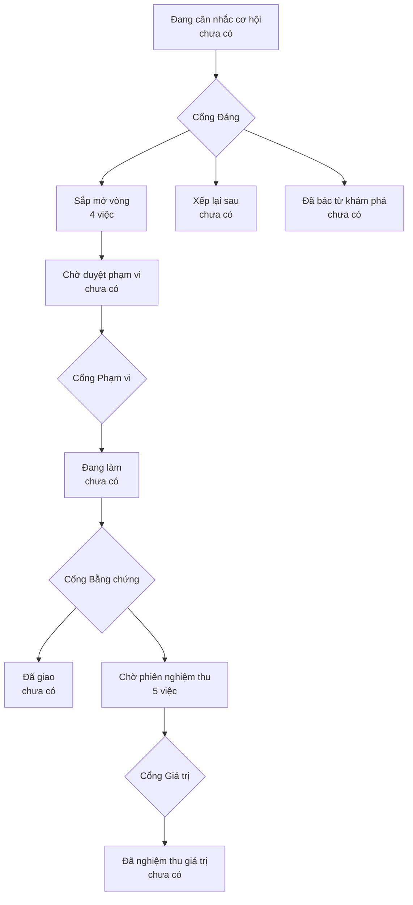

# Bản đồ sản phẩm

> Bản đồ vẽ lại từ hồ sơ của xưởng mỗi lần một người ký một cổng — đừng sửa tay.
> (đọc từ thư mục `_acceptance/` và `.out-of-scope/`)
> Lộ trình: [LO-TRINH.html](LO-TRINH.html)

> **Bốn cổng người** — mỗi cổng là một câu hỏi chỉ người trả lời được:
> **Cổng Đáng** việc này có đáng làm không · **Cổng Phạm vi** bộ tiêu chí
> đã đủ và đúng chưa · **Cổng Bằng chứng** đã làm đúng thứ đã hứa chưa ·
> **Cổng Giá trị** thứ đã giao có ăn thua không.

## Sắp mở vòng

- Bộ dữ liệu mẫu của một sàn thử — một dự án căn hộ, hai mẫu file bảng hàng Excel, lead và chủ nhà giả — sinh từ khuôn của bảng hàng thật, mọi bản ghi mang nhãn mẫu (`du-lieu-mau-san-thu`)
- Mọi thay đổi của hàng đi qua một lệnh API và thành sự kiện chỉ thêm; sáu trạng thái chuẩn, độ tươi và mức đủ thông tin tính ra từ sự kiện (`loi-hang-va-su-kien`)
- Quản trị sàn mời người vào sàn, đặt vai và khu phụ trách; một người giữ được nhiều vai (`moi-nguoi-vai-khu`)
- Người trong sàn mở Quỹ hàng và thấy đúng vỏ theo thiết bị và vai: trên máy tính thanh trên, cột nhà và cột góc nhìn; trên điện thoại bốn tab dưới; telesales chỉ Hôm nay và «+ Lead» (`vo-ung-dung`)

## Đã giao — chờ phiên nghiệm thu

- Bộ đồng bộ đưa đúng phần mỗi người được thấy xuống máy, rút mạng năm phút rồi nối lại không mất thay đổi nào (`bai-thu-dong-bo-mat-mang`)
- Lưới bảng hàng 5.000 dòng × 20 cột cuộn, sửa trên ô và dán 500 ô từ Excel mà không giật trên máy tính văn phòng (`bai-thu-luoi-5000-dong`)
- Link trang khách dán vào Zalo hiện ảnh xem trước, và lượt Zalo tự lấy ảnh không bị tính là khách mở (`bai-thu-zalo`)
- Người trong sàn đăng nhập và vào đúng vùng dữ liệu của sàn mình; chưa gắn sàn thì không thấy gì (`dang-nhap-theo-san`)
- Kho có bộ chuẩn giao diện trước màn sản phẩm đầu tiên: thành phần ReUI, skill giao diện của kho, lint giao diện có mức nợ, sàn thiết kế M1 (`tang-5-giao-dien`)
