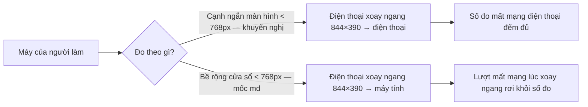

# Thiết kế: ghi thiết bị và lượt mất mạng

Hàng `ghi-thiet-bi-va-mat-mang` (dãy D, đợt dau-khach-nhap), mở theo Hỏi-1 Cổng Phạm vi hàng 52 (chủ kho duyệt 03/11).
Hàng 52 dựng bộ số đo §11 nhưng hai dòng trả «chưa có sự kiện» vì chưa hàng nào ghi: thiết bị của thao tác, và lượt mất
mạng trên điện thoại (`packages/core/src/metrics/danh-sach.ts`, khoá `thieu` của `actions_by_device_role`,
`mobile_offline`). Hàng này ghi hai thứ ấy về máy chủ và cho hai dòng ra số.

## Mục tiêu

Trong hai tuần thử, chủ kho đọc được: (1) thao tác trên hàng làm trên máy tính hay điện thoại, theo vai người làm
(«Ghi nhận thiết bị theo vai có đúng không?»); (2) điện thoại mất mạng bao nhiêu lượt, bao lâu, và bao nhiêu thao tác làm
lúc mất mạng về tới máy chủ («Có cần ngoại tuyến thật không?»).

## Phương án đã chọn

Bốn lớp, đúng đường ghi đang có (một đường ghi — ADR-0008; bộ đồng bộ — ADR-0006, hàng 13, 61):

1. **Cơ sở dữ liệu — migration `028`** (giám sát cấp, luật 25).
   - `listing_events` thêm hai cột: `device text null check (device in ('desktop','mobile'))` và
     `made_offline boolean not null default false`. Sự kiện cũ: `device` null («không rõ»), `made_offline` false. Luật
     chỉ-thêm của bảng giữ nguyên (thêm cột không đụng hàm `su_kien_chi_them`).
   - Bảng mới `offline_sessions`: `company_id`, `user_id`, `device`, `started_at`, `ended_at`, `queued_ops`,
     `recorded_at`; `check (ended_at >= started_at)`, `check (queued_ops >= 0)`, khoá duy nhất
     `(company_id, user_id, device, started_at)`. Bật `enable` + `force row level security` theo
     `app.current_company_id()`; đọc trong sàn, ghi chỉ dòng của chính người đang làm (`user_id = app.current_user_id()`);
     không sửa, không xoá (trigger như `listing_events`); grant `select, insert` cho `quy_hang_app`. Một ca trong
     `packages/db/tests/isolation.test.mjs` (chỉ thêm) — bất biến 1.
   - Không cột nào thuộc lớp `source`: lượt mất mạng chỉ có giờ, thiết bị, số thao tác.

2. **API** (`packages/api`).
   - Thiết bị đi trong đầu yêu cầu `x-quy-hang-device: desktop | mobile`. Giá trị khác hay vắng → ghi `null` (máy cũ chưa
     gửi, công cụ ngoài), không từ chối lệnh — số đo đếm «không rõ». `POST /listings` và `POST /listings/:id/events` đều
     ghi cột `device`.
   - Lệnh đổi hàng nhận thêm khoá `madeOffline: boolean` (khuôn `Command` vẫn `.strict()`; khoá lạ khác vẫn bị từ chối).
     Vắng = false.
   - Đường mới `POST /api/v1/sync/offline-sessions` nhận `{ startedAt, endedAt, device, queuedOps }` (khuôn `.strict()`):
     ghi một dòng cho người đang làm ở sàn đang làm, trả 201; gửi lại cùng `startedAt` của cùng người và thiết bị trả 200,
     không thêm dòng (`on conflict do nothing`) — bộ đồng bộ gửi lại được mà không trùng. `endedAt < startedAt`, thiết bị
     lạ, khoá lạ → 400; chưa đăng nhập 401, chưa gắn sàn 403 — như mọi đường của sàn.
   - Sự kiện API trả (`GET /listings/:id`) mang thêm `device` và `madeOffline` để lõi đọc chung một khuôn.

3. **Bộ đồng bộ trên máy** (`apps/web/src/lib/sync/`, cham-tep D-7 đã duyệt).
   - `thietBi(canhNganPx)` thuần: cạnh ngắn của màn hình (`min(screen.width, screen.height)`) `< 768` → `mobile`, còn
     lại `desktop` — cùng con số `md` của vỏ, nhưng đo loại máy chứ không đo cửa sổ, nên điện thoại xoay ngang vẫn là
     điện thoại (Hỏi-2). `goiFetch` gửi đầu `x-quy-hang-device` đọc lúc gọi.
   - Thao tác mang `madeOffline: true` trong `PendingOp` khi (a) ghi lúc lần thử gần nhất là mất mạng
     (`lastAttempt === "mang"`), hoặc (b) lần gửi đầu của nó gặp mất mạng (máy vừa rớt mạng — lượt gửi dừng vì mất mạng
     thì mọi thao tác chưa gửi trong hàng đợi chưa từng gửi được nhận dấu). Lúc gửi, bộ gửi chép khoá ấy vào lệnh. Thao
     tác ghi và gửi được lúc có mạng không mang khoá.
   - Lượt mất mạng: lần thử chuyển sang `mang` mà ngăn chưa có `offlineSince` → ghi `offlineSince` = giờ lần thử ấy và
     thiết bị lúc ấy. Lần thử kế không phải `mang` → khép lượt (`endedAt` = giờ lần thử ấy, `queuedOps` = số thao tác
     `madeOffline` ghi trong lượt), đẩy vào `offlineOutbox` của ngăn, xoá `offlineSince`. Mỗi lượt thử có mạng gửi
     `offlineOutbox` qua đường mới; 2xx thì bỏ khỏi hộp, lỗi thì giữ để gửi lần sau. Luật gửi hàng đợi, kéo, tự lành của
     hàng 13/61 không đổi.

4. **Lõi số đo** (`packages/core/src/metrics/`, vùng hàng 52 của dãy D).
   - `ListingEvent` thêm hai trường tuỳ chọn `device?: "desktop" | "mobile" | null` và `madeOffline?: boolean`.
   - `actions_by_device_role`: mỗi sự kiện của hàng (mọi loại) có `occurredAt` trong kỳ `[tu, den)`, đếm theo
     thiết bị × vai (mỗi vai của `actorRoles` một ô; không vai → `khong-vai`); thiết bị null → «không rõ». Trả tỉ lệ
     điện thoại trên tổng có thiết bị, kèm chi tiết từng ô.
   - `mobile_offline`: lượt mất mạng có `device = mobile` và `startedAt` trong kỳ — số lượt, tổng phút, lượt dài nhất; số
     sự kiện trong kỳ có `madeOffline` và `device = mobile`.
   - Hai mã bỏ khoá `thieu` trong `DANH_SACH_SO_DO`; bốn mã còn thiếu giữ nguyên.

## Căn cứ các lựa chọn

- Thiết bị = loại máy theo cạnh ngắn màn hình, mốc 768px (Hỏi-2 — chủ kho chọn ở Cổng Phạm vi): «điện thoại» của §11 là
  máy cầm tay ra công trường; xoay ngang không đổi loại máy. Máy tính bảng cạnh ngắn ≥ 768px tính là máy tính.
- Chỉ ghi sự kiện của hàng: dòng `thieu` của hàng 52 nói đúng «Sự kiện có vai người làm nhưng không ghi thiết bị»; lead,
  liên hệ, ảnh có đường ghi riêng — để hàng sau.
- Lượt mất mạng do máy báo khi có mạng lại: máy chủ không thấy lúc máy mất mạng; chỉ bộ đồng bộ biết (hàng 13).
- Ghi mọi thiết bị, số đo lọc điện thoại: §11 hỏi «trên điện thoại»; ghi cả máy tính không tốn gì và đỡ đổi khuôn sau.

## Giới hạn đã biết (khai trước)

- Độ mịn lượt mất mạng theo nhịp thử của bộ đồng bộ (15 giây khi chờ / 30 giây khi yên): lượt ngắn hơn một nhịp có thể
  không thấy; đầu và cuối lượt lệch tối đa một nhịp.
- Máy đóng trang khi đang mất mạng: lượt mở nằm trong kho trên máy, khép ở lần mở trang có mạng kế (giờ khép = lúc ấy).
- Đăng xuất xoá kho trên máy (luật hàng 13): lượt chưa gửi mất theo.
- Thiết bị do máy khai: công cụ ngoài gửi đầu giả được — số đo của sàn thử, không phải bằng chứng an ninh.

## Đặc tả UX

Không chạm màn (xem sổ: bỏ đặc-tả-UX). Không chữ UI mới.

## Hình: Hỏi-2



## Hình: lượt mất mạng

```mermaid
sequenceDiagram
  participant N as Người
  participant D as Bộ đồng bộ trên máy
  participant S as Máy chủ
  D->>S: lượt thử (t1) — lỗi mạng
  Note over D: mở lượt: offlineSince = t1
  N->>D: sửa giá căn (madeOffline)
  D->>S: lượt thử (t2) — lỗi mạng, lượt vẫn mở
  D->>S: lượt thử (t3) — có mạng: gửi thao tác (madeOffline: true, x-quy-hang-device)
  Note over D: khép lượt: endedAt = t3, queuedOps = 1 → hộp gửi
  D->>S: POST /api/v1/sync/offline-sessions (201; gửi lại → 200, không trùng)
```

## Eval cũ được thay (Hỏi-1, chủ kho duyệt 03/11)

| Eval cũ | Tiêu chí mới đo lại nó |
|---|---|
| so-do-hai-tuan-thu/E8 | ghi-thiet-bi-va-mat-mang#AC-9 (ca «chưa có sự kiện: bốn mã nói rõ thiếu gì», eval E9) |

Ca «chưa có sự kiện: sáu mã» của hàng 52 rời `so-do.test.ts`, thay bằng ca bốn mã ở `thiet-bi-mat-mang.test.ts`. Mỗi hàng
sau cho một trong bốn mã còn lại ra số (34, 35, 43, 86) sẽ lại đổi ca ấy theo cùng cách.
