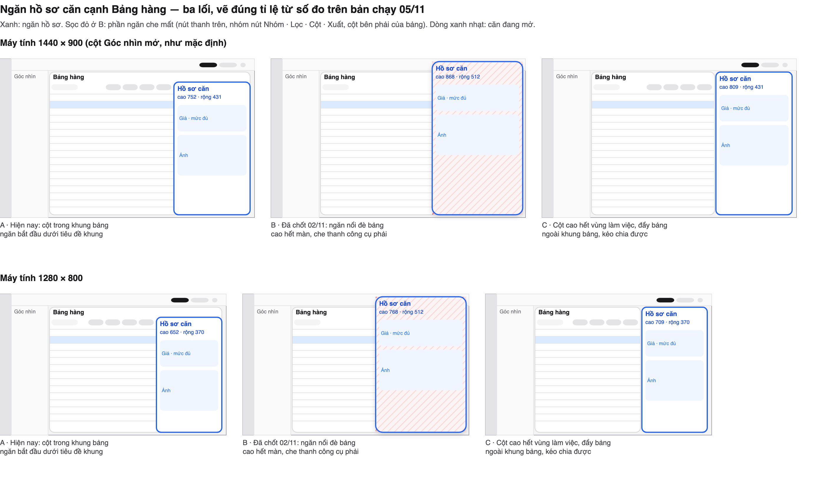

# Đánh giá: ngăn hồ sơ căn cạnh Bảng hàng — trong khung bảng hay cao hết màn

Ngày 05/11 · Người hỏi: chủ kho (Manh Phan) · Loại: đánh giá, chưa sửa mã, chưa mở hàng · Hình:
[`danh-gia-ngan-chi-tiet-can/`](danh-gia-ngan-chi-tiet-can/)

**Chủ kho chọn C (05/11, nguyên văn «Chọn C»).** Sửa ADR-0024 và Tham chiếu §12 đi cùng PR của hàng chuyển Bảng hàng
(mục 5 «Nếu chọn C, đổi gì»); giám sát đợt xếp hàng.

Câu hỏi, nguyên văn: «khuôn chi tiết căn (Sheet Detail) như trong screenshot nên nằm ngoài bố cục của bảng hàng, nghĩa là
full chiều cao màn hình hay như hiện nay».

## Kết luận một đoạn

Nên ra ngoài khung bảng và cao hết vùng làm việc. Điều này **đã chốt từ 02/11**: hồ sơ cạnh bảng thuộc bố cục «Danh sách –
chi tiết». Màn đang chạy chưa chuyển vì Bảng hàng còn mang ngoại lệ có hạn, chờ hàng 79 (chưa mở). Chỗ còn phải chọn là
cách đặt ngăn. Lời chốt 02/11 cho **ngăn nổi đè lên bảng** (lối B). Khuyến nghị đổi sang **cột đứng cạnh bảng, cao hết vùng
làm việc, đẩy bảng sang trái và kéo chia được** (lối C). Lý do: ở Quỹ hàng, đầu chủ làm việc lâu trong ngăn (thêm ảnh, đi
lần lượt từng căn, đổi lọc). Ngăn nổi che mất nhóm nút Nhóm · Lọc · Cột · Xuất và nút +Lead. Ở màn 1280 nó còn che gần hết
bảng, chỉ để lại ba cột.

## 1. Vì sao ngăn đang nằm trong khung bảng

| Điều | Ở đâu | Nói gì |
| --- | --- | --- |
| Hồ sơ cột phải, hàng 17 (01/11) | `docs/design/vo-va-ia.md` dòng «Hồ sơ căn, cột phải»; `design/patterns/ho-so-can.md` | Chuyển thể `solution-crm-4`: «ngăn phủ → cột phải chia đôi bằng `resizable` cạnh Bảng hàng». Ở cột phải, hồ sơ là một phần **trong khung của Bảng hàng**. Đây là thứ đang chạy (`units/ho-so/bang-co-ho-so.tsx`: cột chia 62 / 38, nhỏ nhất 28%). |
| Hệ bố cục, hàng 91 (02/11, chủ kho chốt ở Cổng Phạm vi) | ADR-0024 quyết định 2 và 13; Tham chiếu §12 dòng 02/11 | «Danh sách – chi tiết giữ bảng toàn bề rộng, hồ sơ trượt ra ngăn bên phải» — ngăn nổi `sheet-9`, cách mép 1rem, cao `100svh − 2rem`, rộng 32rem, đè lên bảng mà bảng vẫn bấm được. Đã dựng xong ở bộ bố cục (`NganNoi phuBang`). |
| Ngoại lệ có hạn | `design/patterns/bang-hang.md` | Bảng hàng giữ hình cũ «tới hàng 79» (`bang-hang-theo-loai-hinh`, T2, **chưa mở**). |

Như vậy lối trong ảnh của chủ kho (lối A) là **hình cũ chưa chuyển**, không phải điều đang chốt. Ba chỗ chữ còn lệch nhau,
sẽ dọn trong hàng chuyển màn:

- ADR-0024 tự mâu thuẫn. Quyết định 2 và 13 ghi «ngăn trượt, đè lên bảng», còn ma trận vùng ở quyết định 3 ghi cột phụ của
  Danh sách – chi tiết là «**hồ sơ kéo chia**».
- `vo-va-ia.md` và `ho-so-can.md` vẫn tả hình của hàng 17.
- Ngoại lệ ở `bang-hang.md` ghi lý do «chuyển sang bố cục **Tràn** ở hàng 79». ADR lại xếp «Bảng hàng có hồ sơ cạnh bên»
  vào **Danh sách – chi tiết**.

## 2. Số đo trên bản chạy (05/11, sàn mẫu, căn A-13.01)

Đo bằng trình duyệt trên quyhang.onehub.center, cột Góc nhìn mở như mặc định. Ảnh thật của lối A:
[1440](danh-gia-ngan-chi-tiet-can/hien-tai-1440.png) · [1280](danh-gia-ngan-chi-tiet-can/hien-tai-1280.png). Lối B và C
vẽ đúng tỉ lệ từ số đo này: trang mẫu sống bị tắt ở bản chính thức và chưa màn thật nào mở ngăn nổi cạnh bảng.

| | A · hiện nay | B · đã chốt 02/11 | C · khuyến nghị |
| --- | --- | --- | --- |
| Ngăn bắt đầu | dưới tiêu đề khung «Bảng hàng» (y 132) | mép trên màn hình (y 16) | đỉnh vùng làm việc, ngang tiêu đề khung (y 75) |
| Cao ngăn thấy được, 1440 × 900 | 752 | **868** | 809 |
| Cao ngăn thấy được, 1280 × 800 | 652 | **768** | 709 |
| Rộng ngăn | 38%, kéo 28–50% (431 / 370) | cố định 512 | như A, kéo được |
| Bảng thấy được khi ngăn mở, 1440 | 702 | **631** (ngăn che phần phải) | 697 |
| Bảng thấy được khi ngăn mở, 1280 | 603 — 4 cột (Toà, Mã căn, Loại căn, Diện tích) | **472** — khoảng 3 cột | 598 — 4 cột |
| Nhóm nút Nhóm · Lọc · Cột · Xuất | thấy | **bị che** (nằm ở mép phải bảng) | thấy |
| Nút +Lead, đồng bộ, chuông, tài khoản | thấy | **bị che** khi ngăn mở | thấy |
| Mở hay đóng ngăn | bảng co hay giãn | bảng đứng yên | bảng co hay giãn |

Ghi chú thêm: ở cả hai khổ, khung Bảng hàng cao hơn khung nhìn khoảng 16 điểm, nên trang cuộn nhẹ (đáy khung ở y 916/900
và 816/800). Đây là việc khác, xem «Việc kèm theo».

## 3. Khảo sát: người khác làm thế nào

### 3a. Trên chính kho ReUI Pro (đọc mã gốc các khối bằng khoá Pro, 05/11)

678 khối Pro; lọc mọi khối có bảng hay danh sách kèm ngăn chi tiết, đọc mã từng khối:

| Khối | Ngăn đặt thế nào | Rộng | Ghi chú |
| --- | --- | --- | --- |
| `sheet-9` (ticket), `solution-crm-3` (danh bạ), `solution-crm-4` (deal), `solution-agents-7`, `sheet-14` (nhật ký), `solution-dev-ops-1`, `-2`, `-3`, `data-grid-base-1`, `-2`, `solution-bookings-1` | **ngăn nổi cao hết màn** (`inset-y-4 right-4`, `h-[calc(100svh-2rem)]`), đè lên mọi thứ kể cả thanh trên, có lớp phủ (bảng không bấm được khi ngăn mở) | 26–36rem | Bốn khối dev-ops và nhật ký có **J / K đi tới dòng trước, dòng sau theo đúng thứ tự đang lọc**, nên không cần đóng ngăn để chọn dòng khác |
| `solution-inventory-7`, `-8` (kho hàng) | ngăn nổi cao hết màn | 60rem | gần như một trang |
| `app-shell-11` (vỏ điều hành) | **cột chi tiết đứng cạnh, kéo chia** (`ResizablePanel` 38%, 28–50%), cao hết vùng làm việc, dưới thanh trên | 38% | Cùng tỉ lệ với cột đang chạy ở Quỹ hàng. Đây là khối ReUI cho lối C |
| `solution-crm-9` (bàn deal) | ba cột đứng cạnh nhau (hàng đợi · chi tiết · hoạt động); điện thoại mới dùng ngăn | — | danh sách hẹp, không phải bảng rộng |
| `app-shell-20` (thư) | danh sách và ô đọc đứng cạnh | — | kiểu hộp thư |

Đếm: 13 khối ngăn nổi cao hết màn, 3 khối cột đứng cạnh. **Không khối nào đặt ngăn trong khung bảng, dưới tiêu đề như lối A.**
Ngăn nổi của ReUI là ngăn «xem rồi đóng»: có lớp phủ, không cho bấm bảng khi mở. Quỹ hàng đã bỏ lớp phủ để bảng bấm được
(`phuBang`), tức là dùng ngăn nổi cho việc «làm lâu bên cạnh». ReUI không dựng khối nào theo cách ấy.

### 3b. Sản phẩm khác

| Sản phẩm | Ngăn | Cao | Đè hay đẩy | Phóng to · trang riêng | Điện thoại | Nguồn |
| --- | --- | --- | --- | --- | --- | --- |
| Notion (cơ sở dữ liệu) | «Side peek» mặc định cho bảng, danh sách, bảng thẻ; có «Center peek» và «Full page» | cao hết màn, bên phải | vẫn thấy và sửa được cơ sở dữ liệu bên trái | nút mở trang đầy đủ; chủ không gian chọn mặc định cho từng góc nhìn | trang đầy đủ | [Notion, 20/07/2022](https://www.notion.com/releases/2022-07-20) |
| Airtable (interface) | «Record detail» mở thành sidesheet | cao hết vùng trang | ngăn bên phải; **kéo mép trái để đổi rộng**, nhớ theo trình duyệt | nút trước · sau; bật toàn màn | — | [Airtable support](https://support.airtable.com/docs/airtable-interface-layout-record-detail) |
| Attio | «Open preview» khi rê lên tên bản ghi | ngăn bên phải | xem mà không rời bảng | bấm tên mở trang bản ghi đầy đủ | — | [Attio help](https://attio.com/help/reference/managing-your-data/records/create-and-view-records) |
| HubSpot | «Preview» ở bảng, bấm thẻ ở bảng thẻ | ngăn bên phải | sửa thuộc tính ngay trong ngăn, tự lưu | «View record» mở trang đầy đủ; bố cục ngăn tách khỏi bố cục trang | — | [HubSpot KB](https://knowledge.hubspot.com/records/preview-a-record) |
| Smartsheet | «Record detail panel» bên phải, mở từ số dòng hay nút ở ô chính | ngăn bên phải của lưới | **đứng cạnh lưới** | — | — | [Smartsheet 05/2025](https://www.smartsheet.com/content-center/expanded-row-details-attachments-and-conversations-table-view-now-generally), [06/2025](https://www.smartsheet.com/content-center/easily-open-record-detail-panel-cell-table-view) |
| Salesforce Lightning | «Split View»: danh sách trái, bản ghi phải | cao hết vùng làm việc | **đứng cạnh**; danh sách co còn 4 cột đầu | sửa bản ghi ngay tại chỗ | — | [Salesforce Ben](https://www.salesforceben.com/your-complete-guide-to-salesforce-split-view/) |
| Linear | «Peek»: giữ phím cách để xem nhanh, thả là đóng; chia đôi chỉ có ở Inbox và Triage | nổi | xem nhanh rồi đóng, không làm lâu | mở trang việc | — | [Linear docs](https://linear.app/docs/peek); chia đôi theo [thảo luận 02/2025](https://redlib.hbubli.cc/r/Linear/comments/1iww9tk/open_issue_details_in_side_panel), chưa có tài liệu chính thức |
| Material 3 «list-detail» | màn rộng: danh sách và chi tiết **đứng cạnh**; dòng đang chọn có dấu nối với chi tiết | cao hết vùng | đứng cạnh, chi tiết co giãn | — | **màn hẹp: hai màn chồng** — chọn dòng thì chi tiết thay danh sách | [Android canonical layouts](https://developer.android.com/guide/topics/ui/layout/canonical-layouts), [SAP Fiori list-detail](https://www.sap.com/design-system/fiori-design-android/v26-4/layouts/list-detail/list-detail) |
| Follow Up Boss, Lofty, kvCORE (CRM bất động sản) | không thấy tài liệu chính thức nói có ngăn xem nhanh; bấm người mở **trang hồ sơ riêng** (thông tin bên trái, việc bên phải) | — | — | trang riêng | — | [Lofty](https://help.lofty.com/hc/en-us/articles/360055290591-Lead-Profile-Page), [kvCORE](https://intercom.help/kvcore/en/articles/9380470-kvcore-contact-record-overview) |

Đọc chung:

- **Không ai đặt ngăn trong khung bảng.** Ngăn luôn cao hết màn hay hết vùng làm việc.
- Hai họ lối. **Nổi để xem nhanh** (Notion, Attio, HubSpot, Linear, ReUI): ngăn hẹp, bảng đứng yên, có lối mở trang đầy đủ.
  **Đứng cạnh để làm lâu** (Smartsheet, Salesforce Split View, Material list-detail, ReUI `app-shell-11`): bảng co lại, kéo
  chia được, thanh công cụ vẫn thấy.
- Lối nổi nào cho làm lâu thì cũng bù bằng hai thứ: **kéo đổi rộng** (Airtable, Notion) và **đi dòng trước · sau mà không
  đóng ngăn** (Airtable, ReUI J / K).
- Điện thoại ở mọi nơi là hai màn chồng: chọn thì chi tiết chiếm cả màn. Quỹ hàng đã làm vậy (`/inventory?unit=` trên điện
  thoại mở hồ sơ toàn màn) và ADR-0024 §5 đã ghi. **Cả ba lối không đổi gì trên điện thoại.**

## 4. Được và mất theo việc của người dùng

| Việc | A · hiện nay | B · ngăn nổi đè bảng | C · cột cao hết vùng, đẩy bảng |
| --- | --- | --- | --- |
| Đầu chủ đi lần lượt các căn còn thiếu (lọc «thiếu ảnh», mở căn, thêm ảnh, sang căn sau) | được, nhưng ngăn thấp nhất: ảnh và thuộc tính bị đẩy xuống dưới | ngăn cao nhất; nhưng muốn đổi lọc hay nhóm phải đóng ngăn vì nút bị che | ngăn cao gần bằng B; lọc, nhóm, cột vẫn trong tầm tay |
| Sửa ô trên bảng khi đang xem hồ sơ | được | chỉ ở các cột không bị che | được |
| Giữ ngữ cảnh lọc · nhóm · cuộn | giữ (bảng không dựng lại) | giữ, bảng đứng yên | giữ (như A) |
| Đầu khách so nhiều căn (giá, diện tích, hướng) | so trên bảng; khi ngăn mở thì cột phải bị đẩy ra ngoài | ngăn che cột phải; ở 1280 còn khoảng 3 cột | như A; kéo hẹp ngăn để thấy thêm cột |
| Đọc ảnh và giá trong hồ sơ | 752 / 652 điểm cao | 868 / 768 | 809 / 709 |
| Tạo lead (+Lead) hay xem chuông khi ngăn đang mở | được | phải đóng ngăn | được |
| Khớp hệ bố cục | ngoại lệ có hạn | đúng chữ quyết định 2 và 13 | đúng chữ ma trận vùng «hồ sơ kéo chia» ở quyết định 3; trái chữ quyết định 2 và 13 |
| Khối ReUI làm nguồn | `solution-crm-4` chuyển thể | `sheet-9` (13 / 16 khối Pro có ngăn chi tiết cùng họ) | `app-shell-11` (cột chi tiết kéo chia) + `solution-crm-4` cho ruột hồ sơ |
| Mã phải viết khi chuyển | — | ít: bố cục đã có ngăn nổi | vừa: đổi nhánh Danh sách – chi tiết của bộ bố cục từ ngăn nổi sang cột kéo chia, dùng lại phần kéo chia đang chạy |

## 5. Đề xuất

**Chọn C: hồ sơ căn là cột đứng cạnh bảng, ngoài khung bảng, cao từ đỉnh vùng làm việc tới đáy màn, đẩy bảng sang trái,
kéo chia 28–50% như hôm nay.** Thanh trên của vỏ (tìm mã căn, +Lead, đồng bộ, chuông) giữ nguyên ở trên. Khung «Bảng hàng»
cùng tiêu đề và thanh công cụ co lại bên trái. Phóng to vẫn mở `/units/<mã>`. Điện thoại giữ hồ sơ toàn màn.

Căn cứ:

1. **Việc trong ngăn là việc làm lâu, không phải liếc qua.** Đầu chủ thêm ảnh, gắn mã, đi qua cả danh sách «còn thiếu». Lối
   nổi sinh ra để xem nhanh rồi đóng: Linear chỉ giữ khi đang đè phím, ReUI để lớp phủ chặn bảng. Lối đứng cạnh sinh ra để
   làm song song (Smartsheet, Salesforce, Material).
2. **B che đúng những thứ đầu chủ cần khi làm lâu**: nhóm nút Lọc · Nhóm · Cột · Xuất, nút +Lead và chuông. Ở màn 1280 (máy
   xách tay phổ biến), B để lại khoảng 3 cột bảng.
3. **C lấy gần hết phần cao mà chủ kho muốn**: hơn hôm nay 57 điểm, kém B 59 điểm. C không che gì và giữ được kéo chia đã có.
4. **C vá chỗ ADR tự mâu thuẫn.** Ma trận vùng của chính ADR-0024 đã ghi «hồ sơ kéo chia». Khối nguồn có sẵn ở ReUI
   (`app-shell-11`), cùng tỉ lệ 38 / 28–50 với cột đang chạy.

Nếu giữ B thì phải bù hai thứ như mọi sản phẩm nổi dùng cho làm lâu. Một là phím ↑↓ hay J / K để đi căn trước · sau theo
thứ tự đang lọc mà không đóng ngăn. Hai là kéo đổi rộng ngăn. Còn nhóm nút bị che thì phải tìm chỗ khác.

### Nếu chọn C, đổi gì

- **Quyết định đã niêm phải sửa:** ADR-0024 quyết định 2 (khối nguồn của «Danh sách – chi tiết»: `sheet-9` → `app-shell-11`
  cột kéo chia + ruột `solution-crm-4`) và quyết định 13 (chữ «hồ sơ mở cạnh bảng — nay trượt phải trong ngăn inset» → «cột
  kéo chia cao hết vùng làm việc, bảng vẫn bấm được»). Viết thành một mục «Sửa đổi 05/11» của ADR-0024, không thêm bố cục thứ
  tám. Tham chiếu §12 thêm một dòng 05/11. Sửa cùng lúc ba chỗ lệch nói ở mục 1.
- **Ngăn nổi vẫn giữ** cho ngăn báo, lọc trên điện thoại và Luồng nhiều bước. Chỉ «Danh sách – chi tiết» đổi. Lead đã nhập
  và Đã gửi khai bố cục này nhưng chưa mở ngăn chi tiết, nên không màn nào đang chạy bị đổi theo.
- **Hàng và bậc:** việc chuyển Bảng hàng sang bố cục «Danh sách – chi tiết» (cả B lẫn C) là giao diện ở vùng
  `inventory/**`, `units/**`, **T2**. Không chạm cơ sở dữ liệu, trần dữ liệu hay rào. Hôm nay việc này nằm chờ trong hàng 79,
  một hàng lớn về loại hình chưa mở. Nên tách thành một hàng nhỏ riêng, chạy trước 79 để 79 xây trên hình mới. Cùng vùng tệp
  với 79 nên hai hàng không chạy song song. Giám sát đợt xếp lịch.
- **Không đổi:** bất biến, dữ liệu, quyền, điện thoại, trang khách.

## Việc kèm theo (ngoài câu hỏi, chưa làm)

- Khung Bảng hàng cao hơn khung nhìn khoảng 16 điểm ở 1440 × 900 và 1280 × 800, nên trang cuộn nhẹ cả khung. Gộp vào hàng
  chuyển màn, vì bố cục giữ chiều cao (ADR-0024 quyết định 9).
- Ba chỗ chữ lệch ở mục 1, dọn trong cùng hàng.

## Căn cứ trong kho

ADR-0024 (`docs/adr/0024-he-bo-cuc.md`) quyết định 2, 3, 5, 9, 13 · `docs/product/tham-chieu.md` §12 hai dòng 02/11 hệ bố
cục · `docs/design/vo-va-ia.md` dòng «Hồ sơ căn, cột phải» và «Cột hồ sơ cạnh bảng» · `design/patterns/ho-so-can.md`,
`design/patterns/bang-hang.md` · `apps/web/src/components/bo-cuc/bo-cuc.tsx`, `ngan-noi.tsx` ·
`apps/web/src/app/(app)/units/ho-so/bang-co-ho-so.tsx` · `docs/plan/lo-trinh.json` hàng 79 · mã gốc các khối ReUI Pro nêu
ở 3a (tải bằng khoá Pro qua sổ khối `@reui`, 05/11).
