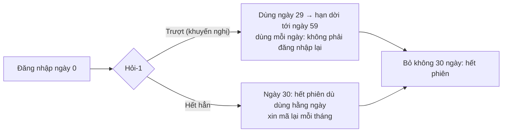

# Phiên đăng nhập 30 ngày — thiết kế

Ngày 31/10/2026 · Việc thêm vào dãy A đợt nen-2 · Hồ sơ `_acceptance/phien-dang-nhap-30-ngay/` · **T2** · đứng trên
ADR-0005 (đăng nhập theo sàn).

Câu giao (chủ kho 31/10, nguyên văn «phiên đăng nhập: 30 ngày»): đổi thời hạn phiên đăng nhập từ mặc định 7 ngày của
better-auth lên 30 ngày, vẫn trượt theo ngày dùng — mỗi ngày dùng đẩy hạn ra thêm, làm mới tối đa một lần mỗi ngày.

## 1. Bài toán

Hôm nay `createAuth` không khai `session`, nên better-auth dùng mặc định: phiên sống 7 ngày, làm mới khi đã quá 1 ngày
kể từ lần làm mới trước. Đầu chủ không dùng app một tuần (nghỉ, đi công trình) là phải xin mã lại.

Có một chỗ không thấy được nếu chỉ đổi cấu hình: hạn phiên nằm ở **hai** nơi — dòng phiên trong cơ sở dữ liệu
(`identity.session.expiresAt`) và cookie `qh.session_token` trên trình duyệt (`Max-Age` = thời hạn phiên, đặt lại mỗi
lần better-auth gửi `Set-Cookie`). Bàn làm việc đọc phiên ở máy chủ, trong tiến trình (`readMe` → `getApi().request`),
nên khi better-auth làm mới dòng phiên thì `Set-Cookie` mới bị vứt — trình duyệt không bao giờ nhận. Kết quả: dòng phiên
trượt nhưng cookie vẫn hết 30 ngày sau lần đăng nhập. «Trượt theo ngày dùng» chỉ đúng khi cookie cũng được đặt lại.

## 2. Mô hình

| Gì | Giá trị | Ở đâu |
|---|---|---|
| Thời hạn phiên | 30 ngày (`SESSION_EXPIRES_SEC = 2 592 000`) | `packages/api/src/auth/constants.ts` → `createAuth({ session })` |
| Nhịp làm mới | 1 ngày (`SESSION_UPDATE_AGE_SEC = 86 400`) — phiên dùng lại sau hơn 1 ngày thì hạn đẩy về «bây giờ + 30 ngày» | như trên |
| Cookie trượt | Mỗi lần mở một trang của bàn làm việc, bước chặn đầu (`apps/web/src/proxy.ts`) hỏi `GET /api/v1/auth/get-session` trong tiến trình và chép mọi `Set-Cookie` better-auth trả sang phản hồi trang | `apps/web/src/proxy.ts` |

- Ghi thành hằng như các hằng mã đăng nhập (ADR-0005 mục 1), để test kiểm đúng số, không dựa vào mặc định thư viện.
- Proxy chỉ hỏi phiên khi có cookie phiên (cả hai tên `qh.session_token` và `__Secure-qh.session_token`) và chép
  nguyên văn mọi `Set-Cookie` của better-auth — không dựng lại cookie, để giữ `HttpOnly`, `SameSite`, `Secure`; better-auth chỉ trả `Set-Cookie` khi thật sự làm mới (quá 1 ngày) hay khi
  phiên đã hết (xoá cookie). Không làm mới thì phản hồi trang không đổi. Giá: thêm một lần đọc dòng phiên mỗi lần mở
  trang — trang dựng ở máy chủ đã đọc phiên qua `/me`, nên đây là lần thứ hai, cùng chỉ mục khoá chính.
- Gọi API từ trình duyệt (`fetch('/api/v1/...')`) không đặt lại cookie: người dùng mở app là mở trang, nên lần mở đầu
  của mỗi ngày đã làm mới cả hai nơi.
- Phiên quá hạn (không dùng 30 ngày): `/me` trả 401 như cũ, trang đưa về `/login`.

## 3. Không làm ở việc này

- Lựa chọn «ghi nhớ đăng nhập» trên màn đăng nhập, hay thời hạn khác nhau theo thiết bị.
- Trần tuyệt đối (bắt đăng nhập lại sau N ngày dù dùng hằng ngày) — better-auth không có sẵn; câu giao không đòi.
- Đăng xuất mọi thiết bị, danh sách phiên đang mở.
- Đặt lại cookie khi chỉ gọi API từ trình duyệt mà không mở trang nào.

## 4. Câu cần người

- **Hỏi-1 — phiên 30 ngày trượt theo ngày dùng, hay hết hẳn 30 ngày sau lần đăng nhập?** Chữ chủ kho chỉ là «phiên
  đăng nhập: 30 ngày»; «trượt» là cách hiểu khi giao việc. Khuyến nghị: **trượt**, làm mới tối đa mỗi ngày một lần, chưa
  đặt trần — hôm nay phiên 7 ngày đã trượt ở máy chủ, việc này chỉ kéo dài và cho cookie trượt theo. Lối khác: hết hẳn 30
  ngày sau đăng nhập (tắt làm mới, hoặc giữ trượt nhưng chặn theo `createdAt` ở bước chặn đầu — không cần migration) —
  giá: người dùng hằng ngày vẫn phải xin mã lại mỗi tháng. Chọn trượt thì cookie lộ mà kẻ giữ dùng mỗi ngày sống tới khi
  đăng xuất. Hợp đồng viết theo khuyến nghị; chọn lối khác thì AC-2 và AC-5 đổi.

## Đặc tả UX

Bỏ — việc không đổi màn nào (sổ quyết định, dòng «bỏ đặc-tả-UX»).

### Hình Hỏi-1

