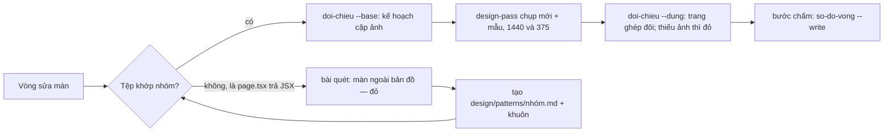

# Vòng giao diện đi qua bản đồ khuôn — thiết kế (hàng 60, QK3 + QK4)

Hồ sơ `_acceptance/vong-giao-dien-qua-ban-do/`. Đứng trên hàng 58 (bản đồ khuôn, `design/patterns/`) và hàng 59 (răng
giữ khuôn). Nguồn: bản phạm vi `docs/plan/pham-vi-ban-do-khuon-3110.md` mục QK3, QK4; trang tri thức
`docs/tri-thuc/wiki/dot/ban-do-khuon-3110.md`; finding kit §7.4–§7.5, §11.4–§11.6 (bản chép ở
`docs/tri-thuc/raw/2026-10-31-ban-do-khuon-thu-nghiem/`).

## 1. Vấn đề

Hàng 58–59 giữ được phần tất định: màn của một nhóm phải dựng khuôn, không nhập khối cấm. Còn ba lỗ:

1. **«Đọc như cùng một sản phẩm»** không tất định được. Finding §7.6 chốt mức trần là T3: máy chụp màn mới cạnh màn mẫu
   của nhóm, cùng khổ, cùng trạng thái; người đọc lúc rảnh ở cổng sẵn có. Kit chưa có bước chụp này (`design-pass` 2.36.0
   không đọc `mau_dang_chay`), nên kho tự dựng phần tất định của nó: kế hoạch chụp và trang ghép đôi.
2. **Màn đầu của một nhóm mới lọt khỏi bản đồ.** Luật `KH-tt-roi-nhom` buộc màn thật rời `nhan_dien` của trang tạm, nhưng
   rời xong thì tệp không thuộc nhóm nào và mọi bài kiểm im. Hàng 14 (Bảng hàng) là màn đầu tiên sẽ đi đúng đường đó.
3. **Kit cần số.** Mỗi vòng chạm giao diện phải ghi số tệp theo khuôn, số lần răng bắt, số lệch lọt qua lưới, cùng các
   dòng số của luật kit — để kit đếm cho điều kiện mở KH-C1…KH-C5.

## 2. Phương án

### 2.1 Đối chiếu màn mới cạnh màn mẫu — `packages/ui-lint/doi-chieu.mjs`

Ba chế độ, cùng đọc bản đồ qua `lib/ban-do.mjs`:

- `--base <ref> --slug <slug>`: lấy tệp đổi so `<ref>` (cả tệp mới chưa theo dõi), mỗi tệp khớp `nhan_dien` của một nhóm
  → một mục kế hoạch: nhóm, tệp mới, màn mẫu (`mau_dang_chay.tep`, `duong`), trạng thái × khổ. Khổ cố định `1440` và
  `375` (khổ AGENTS và `vo-va-ia.md` đã dùng ở hồ sơ 58). Trạng thái lấy từ `mau_dang_chay.trang_thai`. Ghi
  `_acceptance/<slug>/doi-chieu/ke-hoach.json` và in mỗi cặp ảnh một dòng kèm tên tệp ảnh phải chụp:
  `<nhóm>--<trạng thái>--<khổ>--moi.png` và `…--mau.png`. Vòng không chạm tệp nhóm nào → một dòng «đối chiếu: vòng không
  chạm màn của nhóm nào», không ghi tệp, thoát 0.
- `--dung <slug>`: đọc `ke-hoach.json` và các ảnh trong `doi-chieu/`, dựng `doi-chieu/index.html` — mỗi cặp một hàng, hai
  ảnh cùng bề ngang, nhãn «màn mới · <tệp>» và «màn mẫu · <đường>». Cặp thiếu ảnh → ô báo «thiếu ảnh <tên tệp>», dòng
  stderr gọi tên, thoát 1. Đủ → «đối chiếu: N cặp đủ», thoát 0. Trang tự đủ (ảnh nhúng base64), mở được trên điện thoại.
- `--mau`: kế hoạch cho riêng màn mẫu của mọi nhóm (không có màn mới) — dùng để chứng mỗi `mau_dang_chay` chạy được; mục
  thứ hai của QK3.

Ai chụp: phiên `design-pass` của vòng (trình duyệt trong app), theo bước thêm vào skill `quy-hang-ui` — skill mà
`design-pass` nạp làm luật thiết kế (`design_pass.ds_skill`). Máy không tự chạy trình duyệt trong lệnh: kho không có
Playwright và hồ sơ trước đều chụp bằng phiên có trình duyệt. Phần tất định nằm ở lệnh (cặp nào, tên ảnh, ghép đôi, thiếu
thì đỏ); phần chụp đi qua phiên.

### 2.2 Màn ngoài bản đồ — răng của luật «nhóm mới tạo mục bản đồ»

Thêm vào `lib/ban-do.mjs` một hàm `manNgoaiBanDo(root, banDo)`: mọi `apps/web/src/app/**/page.tsx` có thành phần xuất mặc
định trả JSX mà không khớp `nhan_dien` (hay ngoại lệ) của nhóm đơn vị màn nào → một lệch nhóm `ngoai-ban-do`, điều lệch
«màn chưa thuộc nhóm nào — vòng dựng màn đầu của nhóm mới tạo design/patterns/<nhóm>.md và khuôn (vo-va-ia.md §2)».
Trang chỉ chuyển hướng (không trả JSX, ví dụ `app/page.tsx`) không phải màn nên im.

Nối vào cả ba chỗ đang chạy bài quét: `ban-do-khuon.mjs` (đầy đủ và `--base` — `--base` không được thoát sớm «không tệp
nào của nhóm đổi» khi vòng đổi một màn ngoài bản đồ), và `kiem-chuan.mjs` qua chính hàm kiểm của `ban-do-khuon` (dòng
«khuôn: … lệch» đếm cả lệch này). Cây hiện tại: mọi `page.tsx` trả JSX đều thuộc trang tạm, xác thực hay cài đặt sàn → 0
lệch, dòng tóm tắt của hàng 59 không đổi.

Đường đi của màn đầu nhóm mới (Bảng hàng, hàng 14): dựng màn thật ở `(app)/inventory/page.tsx` → trang tạm đỏ (gốc không
phải `Placeholder`) → đưa tệp ra khỏi `nhan_dien` trang tạm → màn ngoài bản đồ đỏ → thêm `design/patterns/bang-hang.md` +
khuôn → xanh. Không có đường im nào giữa chừng.

### 2.3 Số đo mỗi vòng giao diện — `packages/ui-lint/so-do-vong.mjs`

`--slug <slug> --base <ref> [--write] [--bao]`. Ghi `_acceptance/<slug>/khuon-so-do.json`:

| Khoá | Lấy từ |
|---|---|
| `tep_theo_khuon` | tệp vòng đổi (so `<ref>`) mà bài quét xếp «theo khuôn», theo nhóm |
| `rang_bat` | số lệch khuôn (cả màn ngoài bản đồ) bài quét báo trên từng commit của vòng (`<ref>..HEAD`), đếm mỗi cặp (tệp, điều lệch) một lần, trừ lệch còn ở HEAD |
| `lech_lot` | số dòng của sổ `docs/design/lech-lot.md` ghi vòng này là vòng làm ra lệch |
| `kit` | dòng `gio-may` cuối của `run-log.jsonl` (giờ máy, giờ chờ, token ra, % hạn mức tuần) + số lượt gọi người đếm từ sổ quyết định (dòng `seal` và dòng `gate1`/`gate2` có `decided_by`) |

`--bao` in một dòng báo cho kênh liên máy kit (issue #308 của acceptance-gate-kit):
`quy-hang · <slug> · khuôn <n> tệp · răng bắt <k> · lệch lọt <j> · giờ máy <g> · gọi người 
`. Lệnh KHÔNG đăng — đăng là
việc ra ngoài kho (xem Hỏi-1).

Răng bắt trên commit đo bằng cách dựng cây của từng commit vào thư mục tạm (`git worktree add --detach`) rồi chạy hàm kiểm
của HEAD trên cây ấy. Giới hạn khai: lần bắt trước khi commit (lint trong trình soạn, hook cuối lượt) không đếm được.
Không dựng được cây của một commit (git lỗi) thì lệnh từ chối — thoát 2, nêu commit, không ghi số — thay vì ghi một
`rang_bat` thiếu; luật «máy kiểm phải nói điều nó không làm được» (tri thức thiết kế `verification-honesty`).

Sổ «lệch lọt»: `docs/design/lech-lot.md`, một bảng `| Ngày | Màn | Lệch chủ sản phẩm thấy | Vòng làm ra |`. Chủ sản phẩm
báo lệch khi dùng, máy ghi một dòng. Bảng rỗng lúc tạo.

### 2.4 Luật cho người và tác tử

- `docs/design/vo-va-ia.md` §2, sau đoạn «Bản đồ khuôn»: ba đoạn — **Nhóm mới** (màn đầu tiên của một archetype chưa có
  trong bản đồ tạo mục bản đồ và khuôn trong chính vòng ấy, theo khối đích ở bảng dưới; vòng sau của nhóm đi qua khuôn;
  bài quét đỏ «màn ngoài bản đồ» cho tới khi có mục), **Đối chiếu** (vòng chạm màn của nhóm chụp màn mới cạnh màn mẫu
  bằng `doi-chieu.mjs`, ảnh ở Cổng Phạm vi), **Số đo** (vòng chạm giao diện ghi `khuon-so-do.json` bằng
  `so-do-vong.mjs --write` ở bước chấm; báo kit sau mỗi ba vòng).
- Skill `quy-hang-ui` (`.agents/skills/quy-hang-ui/SKILL.md`, nạp qua `.claude/skills/quy-hang-ui`): mục mới «Vòng giao
  diện qua bản đồ khuôn» — xếp nhóm trước khi dựng, đọc tệp màn mẫu, nhóm mới thì tạo mục bản đồ cùng vòng, ba lệnh và
  thứ tự chạy trong `design-pass` và bước chấm. Bảng luật thêm dòng «màn ngoài bản đồ».

## 3. Lựa chọn và căn cứ

- **Chụp bằng phiên, lệnh chỉ lập kế hoạch và ghép.** Lối khác: lệnh tự chụp bằng Playwright — chết vì kho không có
  Playwright, thêm phụ thuộc trình duyệt vào CI cho một bước người đọc lúc rảnh; hồ sơ 58 đã chụp bằng phiên.
- **Khổ 1440 và 375.** Hai khổ mà hồ sơ 58 (E6, E7) và luật vỏ đã dùng; khổ khác chưa ai đọc.
- **Răng màn ngoài bản đồ nằm trong bài quét sẵn có** thay vì một lệnh riêng: lệnh riêng thì kiem-chuan và chấm theo vòng
  không gọi, lỗ cũ còn nguyên.
- **Răng bắt đếm trên commit.** Lối khác: hook ghi mỗi lần lint bắt — chạm `.claude/` (rào của kho, T3) cho một số đo.
- **Báo kit là Hỏi-1** (khó-đảo: đăng ra ngoài kho).

## 4. Hỏi người

- **Hỏi-1 — đăng báo lên issue #308 của kit.** QK1 và QK2 đã ký (hồ sơ 58, 59), nên bản phạm vi đòi một dòng báo ngay.
  Khuyến nghị: máy đăng một bình luận lên issue #308 sau khi hàng này gộp, gồm số của hàng 58, 59, 60, rồi đăng tiếp sau
  mỗi ba vòng giao diện. Lối khác: máy chỉ soạn dòng trong hồ sơ, chủ sản phẩm tự đăng — mỗi lần báo thêm một việc tay.

## 5. Ngoài phạm vi

- Khuôn cho nhóm chưa có màn (Bảng hàng…) — sinh cùng màn đầu tiên, hàng 14.
- Đưa bước chụp vào chính skill `design-pass` của kit, khối «Khuôn» trên thẻ cổng — việc của kit (KH2, KH3).
- Tự chụp không cần phiên (Playwright) — xem §3.
- Đường «chạy» (`data-khuon` trên phần tử gốc) — kho là React, đường tĩnh đủ.

## 6. Hình

