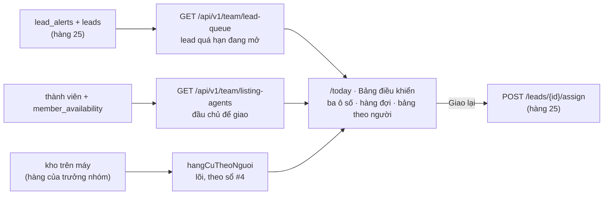

# Hôm nay của Trưởng nhóm — thiết kế (hàng 42)

Ngày 04/11/2026 · hồ sơ `_acceptance/hom-nay-truong-nhom/` · T2 · nguồn: Tham chiếu §2 (dòng Trưởng nhóm :31), §9 (:244
«Hôm nay | Lead quá hạn, hàng cũ theo người, ngoại lệ | Trưởng nhóm · máy tính | TN1»), luật 18, 20; ADR-0024 (bố cục
Bảng điều khiển, `stats-7` + `data-grid-grouping-2`); `docs/design/vo-va-ia.md` §2 dòng «Hôm nay, trưởng nhóm»
(`dashboard-6` bỏ biểu đồ); hồ sơ `chia-lead-va-han` (hàng 25) và `hom-nay-dau-chu` (hàng 22) đã ký.

## Việc

Hàng 25 đã ghi lời báo lead quá hạn và «chưa chia được» (`lead_alerts`) và có lệnh giao lại cho trưởng nhóm
(`POST /api/v1/leads/{id}/assign`), nhưng chưa có màn: trưởng nhóm không có vai Đầu chủ mở `/today` chỉ thấy chỗ trống.
Hàng 42 dựng màn ấy trên máy tính: ba ô số, hàng đợi lead quá hạn có nút giao lại, bảng hàng cũ theo đầu chủ.

## Hình

## Lựa chọn máy đã quyết

1. **Lead quá hạn đang mở đọc qua một lối API mới** `GET /api/v1/team/lead-queue` (chỉ `team_lead`): mỗi lead đang mở
   một dòng với loại việc cần làm — `unrouted` (chưa có người), `accept_overdue` (quá hạn nhận, chưa nhận),
   `first_call_overdue` (quá hạn gọi, chưa gọi) — tính từ trạng thái lead hiện tại và hai hạn đã đóng dấu lúc chia, không
   từ lời báo đã ghi (bảng `lead_alerts` không có cột «đã xử lý»). Lead đã trả lại, đã nhận và gọi, hay đã giao lại còn
   trong hạn mới thì không vào. Không cột số chủ. Không migration: API đọc bảng `leads` bằng vai `quy_hang_app` qua luật
   theo dòng hiện có.
2. **Danh sách đầu chủ để giao** `GET /api/v1/team/listing-agents` (chỉ `team_lead`): mã người, tên hiển thị, đang nghỉ,
   số lead đang mở. Không email, không số điện thoại. `GET /company/members` của quản trị sàn không mở cho trưởng nhóm.
3. **Phạm vi cả sàn** cho hàng đợi và danh sách đầu chủ: sàn chưa có «Nhóm» (sổ K5).
4. **Hàng cũ theo đầu chủ tính trên máy từ kho đồng bộ của trưởng nhóm** (phạm vi đếm chốt ở Hỏi-5) (như Hôm nay đầu chủ, luật khuôn
   `KH-hn-tren-may`), bằng hàm lõi `hangCuTheoNguoi(can, homNay, cauHinh)`: mỗi đầu chủ giữ căn → số căn đang mở, số căn
   «Cần gọi lại» theo `freshness` với `queue.call_back_after_days` của sổ (hàng 81), tỉ lệ tươi. Căn chưa có đầu chủ giữ
   gom một dòng «Chưa có người giữ». Chỉ căn trưởng nhóm đã được đồng bộ xuống — không đếm hộ căn trưởng nhóm không thấy.
5. **Giao lại dùng nguyên lệnh của hàng 25**; lỗi máy chủ (lead căn trùng, người nhận không phải đầu chủ) hiện nguyên
   câu lỗi trên dòng, dòng ở lại. Giao xong dòng rời hàng đợi (đọc lại lối 1).
6. **Bố cục Bảng điều khiển của ADR-0024** cho vùng trưởng nhóm; vùng đầu chủ giữ bố cục Tràn. Không có bản điện thoại
   (ADR-0024: Bảng điều khiển không có trên điện thoại) — điện thoại trưởng nhóm thấy một dòng «mở trên máy tính».
7. **Nhóm khuôn mới `hom-nay-truong-nhom`** ở `design/patterns/`, gỡ hai `ngoai_le_han` của nhóm `hom-nay-dau-chu` đặt
   hạn ở hàng này. Thêm nhóm khuôn mở bước phân kỳ ba lối (ADR-0019) — xem «Chỗ hở».

## Hỏi chủ kho

- **Hỏi-1 — ngoại lệ bản đầu gồm gì.** Khuyến nghị: ngoại lệ = lead «chưa chia được» (máy không tìm được người theo cách
  chia của sàn) — loại duy nhất máy đã ghi; «ngoại lệ khi lên bảng» chưa có mã ở hàng nào. Ô số «Ngoại lệ» đếm lead chưa
  chia được, ô «Lead quá hạn» đếm lead đã về người mà quá hạn nhận hay gọi. Lối khác: gộp cả hai vào một hàng đợi «cần
  trưởng nhóm» không tách ô — gọn hơn, nhưng mất số đo riêng của lead không ai nhận.
- **Hỏi-2 — người có cả vai Trưởng nhóm lẫn Đầu chủ.** Khuyến nghị: `/today` hiện bảng điều khiển của trưởng nhóm trước,
  hàng đợi của chính mình (đầu chủ) bên dưới, cùng một trang. Lối khác: hai thẻ chuyển qua lại — gọn màn, nhưng thêm một
  lần bấm và giấu một nửa việc.
- **Hỏi-5 — hàng cũ đếm căn nào.** Vai không mở «Chỉ tôi»: căn chưa từng Đang bán không xuống máy trưởng nhóm. Khuyến
  nghị: đếm trên máy (căn toàn sàn), dưới bảng ghi «chỉ tính căn toàn sàn». Lối khác: lối máy chủ đếm hộ cả căn «Chỉ
  tôi», chỉ trả số theo người — đủ hơn nhưng nới trục ai thấy hàng đã khoá (K5). Ô «Hàng cũ» = tổng căn cần gọi lại.
- **Hỏi-3 — tập điều kiện cố định hay của sàn** (ADR-0022, dòng «ta cứng — họ cấu hình» ở bảng đối chiếu): «hàng cũ» và
  «quá hạn» đọc ngưỡng từ sổ (sàn đổi được ở hàng 48); còn ba ô và cách chia ngăn của màn giữ cứng ở bản đầu. Khuyến nghị:
  giữ cứng — lý do «nghĩa chuẩn để so giữa các sàn» (ba con số phải cùng nghĩa ở mọi sàn để so phễu). Lối khác: cho sàn
  thêm ô từ tập điều kiện của bộ nhóm hàng 22 — linh hoạt, nhưng mở một bộ dựng bảng điều khiển trước khi có sàn thứ hai.

## Đối chiếu ngành (ADR-0022)

Nguồn: [Đối chiếu ngành §3, §4, §9](../../product/doi-chieu-nganh.md).

| Năng lực | RESO | Follow Up Boss | Lofty | BoomTown | Ta làm | Ta cứng — họ cấu hình |
| --- | --- | --- | --- | --- | --- | --- |
| Danh sách việc quá hạn | `SavedSearch` (người tự tạo) | Tasks: Quá hạn, Hôm nay, Sắp tới — cố định (§4) | Smart Call List quá hạn — cố định (§4) | To-Do Quá hạn — cố định (§4) | hàng đợi lead quá hạn, ngưỡng theo sổ | không — cùng hình cố định |
| Lead không ai nhận | không có | chưa kiểm | bể ai nhận trước (§3) | Lead Matching, luật khớp đầu (§3) | ngoại lệ «chưa chia được» + giao tay | không — cách chia đã là cấu hình (hàng 25) |
| Bảng theo người cho quản lý | không có | chưa kiểm | chưa kiểm | chưa kiểm | bảng theo đầu chủ, tỉ lệ tươi | **có — Hỏi-3** (ô và cột cố định) |

## Đặc tả UX

<!-- <<<UX-SPEC-TEMPLATE -->
## Đặc tả UX

### 1. Luồng

- Suôn sẻ: mở app (trang đích `/today` của trưởng nhóm) → đọc ba ô số → bấm «Giao lại» trên một lead quá hạn → chọn đầu
  chủ → dòng rời hàng đợi, ô số giảm (điểm ra: ở lại `/today`).
- Biên: không lead nào quá hạn → hàng đợi rỗng với câu «Không lead nào quá hạn»; sàn chưa có đầu chủ nào → chọn người
  rỗng, nút giao tắt kèm lý do; người đang nghỉ hiện nhãn «Đang nghỉ», vẫn chọn được.
- Lỗi & quay lại: giao lại bị từ chối (lead căn trùng…) → dòng ở lại, hiện câu lỗi của máy chủ dưới dòng; mất mạng →
  ba ô và hàng đợi giữ số lần đọc cuối kèm dải «Đang mất mạng», nút giao tắt.

### 2. Kiểm kê màn

| Màn | MỘT việc của màn | Vào từ / ra tới |
|---|---|---|
| Hôm nay, trưởng nhóm | Xử lý lead quá hạn và lead chưa chia được của nhóm, nhìn hàng cũ theo người | trang đích sau đăng nhập · nhà Hôm nay / hồ sơ căn |

### 3. Bảng trạng thái

<!-- <<<UX-STATE-TABLE -->
| Trạng thái | Màn | Hiển thị gì | Người làm gì tiếp |
|---|---|---|---|
| ST-hntn-dang-tai | Hôm nay, trưởng nhóm | khung ba ô và bảng ở dạng xương | chờ |
| ST-hntn-mac-dinh | Hôm nay, trưởng nhóm | ba ô số, hàng đợi lead quá hạn và ngoại lệ, bảng theo đầu chủ | giao lại, mở căn |
| ST-hntn-trong | Hôm nay, trưởng nhóm | ba ô bằng 0, «Không lead nào quá hạn», bảng «Chưa có căn nào» | không việc |
| ST-hntn-loi | Hôm nay, trưởng nhóm | «Không tải được lead quá hạn» + nút «Thử lại»; bảng theo người vẫn hiện (dữ liệu trên máy) | thử lại |
| ST-hntn-mat-mang | Hôm nay, trưởng nhóm | số lần đọc cuối + dải «Đang mất mạng», nút giao tắt | chờ có mạng |
| ST-hntn-giao-loi | Hôm nay, trưởng nhóm | dòng ở lại, câu lỗi máy chủ dưới dòng | chọn người khác hay bỏ |
<!-- UX-STATE-TABLE>>> -->

### 4. Hành vi

- Hàng đợi xếp lead quá hạn lâu nhất trước; mỗi dòng: toà · căn · loại việc («Chưa chia được» / «Quá hạn nhận» / «Quá hạn
  gọi») · đầu chủ hiện tại · quá hạn bao lâu.
- Chọn người: danh sách đầu chủ của sàn, người đang nghỉ có nhãn, số lead đang mở cạnh tên; phím Enter giao, Esc đóng.
- Khổ dưới `md`: một dòng «Hôm nay của trưởng nhóm mở trên máy tính» (ADR-0024).

### 5. Xuất xứ component

| Component | Nấc (dùng / ghép / mở rộng / tạo) | Vì sao (1 dòng) |
|---|---|---|
| Ba ô số (`stats-7` của bố cục Bảng điều khiển) | dùng | khối đích ADR-0024 |
| Bảng theo người (`data-grid` đã cài, khuôn `data-grid-grouping-2`) | dùng | khối đích ADR-0024; thành phần đã cài ở `components/reui/data-grid` |
| Hàng đợi lead quá hạn (`data-grid` + `Badge` `-light`) | ghép | `vo-va-ia.md` §2 «hàng đợi ngoại lệ kèm nút làm ngay» |
| Chọn người giao (`Select`/`Command` của shadcn đã cài) | dùng | danh sách ngắn, có tìm |
| Khung bố cục (`components/bo-cuc`) | dùng | hàng 91 |

### 6. Khuôn IA đã chọn + căn cứ

Khuôn IA: bảng-điều-khiển (dashboard-first)
Căn cứ: ADR-0024 đã chốt bố cục «Bảng điều khiển» cho Hôm nay trưởng nhóm; `vo-va-ia.md` §2 archetype Dashboard grid. Không
tra thêm — khuôn đã chốt ở ADR.
### 7. Thẻ việc

| Trường | Giá trị |
|---|---|
| Ai dùng | Trưởng nhóm |
| Việc chính | Giao lại lead quá hạn hay chưa chia được, và thấy đầu chủ nào đang để hàng cũ |
| Tần suất | mỗi ngày nhiều lần |
| Số bản ghi | vài chục |
| Thiết bị | máy tính |
<!-- UX-SPEC-TEMPLATE>>> -->

## Chỗ hở

- Nhóm khuôn mới `hom-nay-truong-nhom` mở bước phân kỳ ba lối (ADR-0019): Trong kho (khung bố cục + `data-grid` và
  `stats-7` đã cài), ReUI (`dashboard-6` bỏ biểu đồ, tải bằng CLI với khoá Pro), Vẽ mới. Trang `/proto/hom-nay-truong-nhom`
  gửi kèm thẻ Cổng Phạm vi; gỡ sau khi chủ kho chọn lối (luật đợt 45).

## Không làm (Out of scope)

- Đẩy thông báo lead quá hạn lên điện thoại trưởng nhóm — hàng 26 (câu giao chỉ nói đầu chủ).
- Phễu, tốc độ gọi theo người, biểu đồ (`dashboard-6` bỏ vùng biểu đồ) — trang Đội.
- «Ngoại lệ khi lên bảng» và lead căn trùng như loại ngoại lệ — chưa có mã ở hàng nào (Hỏi-1).
- Bản điện thoại của bảng điều khiển (ADR-0024).
- Đổi đầu chủ giữ căn từ bảng hàng cũ — lối có sẵn ở hồ sơ căn.
