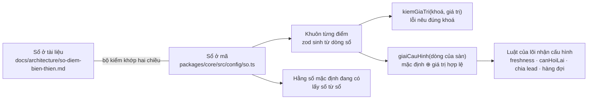

# Sổ điểm biến thiên ở lõi — thiết kế (hàng 81)

Ngày 04/11/2026 · hồ sơ `_acceptance/so-diem-bien-thien/` · T2, nền, không màn · nguồn: ADR-0018 quyết định 1, 2, 6
(«Sổ khớp», «Hai điểm và hai biên»), [Sổ điểm biến thiên](../../architecture/so-diem-bien-thien.md), bản phạm vi
`docs/plan/pham-vi-cau-hinh-theo-san.md` (CH1, CH2), trang tri thức `wiki/dot/cau-hinh-theo-san-0111.md`.

## Việc

Hằng số của sàn đang rải ở từng hàng: `CALL_BACK_AFTER_DAYS` (freshness), `MUC_HOI_LAI_DOI_GIA_PHAN_TRAM` (hỏi lại khi
đổi giá), `DEFAULT_LEAD_ROUTING` + `DEADLINE_MINUTES` (chia lead), `QUEUE_DEFAULT_DAYS` + `QUEUE_DAY_RANGES` (hàng đợi
Hôm nay), `MAC_DINH_ANH_THAT_TOI_THIEU` + `KHOANG_ANH_THAT_TOI_THIEU` (Sẵn sàng bán), `CAU_HINH_MAC_DINH` (luật ẩn
trang khách), `TI_LE_BAO_PHI_MAC_DINH` (giá về tay). Mỗi hàng tự kiểm khoá của mình với thông điệp khác nhau. Hàng 81
dựng một chỗ khai ở lõi, cho các hằng ấy lấy số từ đó, và cho luật nhận cấu hình làm tham số. Không cơ sở dữ liệu, không
API, không màn — đó là hàng 82 và 45–50.

## Hình

## Lựa chọn

1. **Sổ là một mảng dữ liệu `as const` ở `packages/core/src/config/so.ts`** (ADR-0018 quyết định 1, lối A): mỗi dòng
   một điểm của phần A sổ tài liệu — số thứ tự (`#`), khoá, tên điểm, kiểu (`int` · `decimal` · `bool` · `enum` · `set`
   · `text` · `map`), mặc định, khoảng (min/max, giá trị cho phép, độ dài tối đa, «không nhỏ hơn» khoá khác), vai được
   đổi (mã vai của `navigation.ROLES`), ghi đè dưới sàn (chữ hay không), hiệu lực, lớp dữ liệu, tình trạng (`mo` /
   `de_xuat`), hàng màn. Phần B (ứng viên) và C (khoá) không vào sổ mã: chúng không có khoá giá trị.
2. **Hiệu lực ba giá trị**: `moi` (đối tượng mang số lúc tạo), `tinh_lai` (đọc lúc tính), `lan_sau` (mẫu và lần nhập,
   lần phát, lần gửi, lần đổi trạng thái sau — #25, #26, #27, #33). Sổ tài liệu đã viết bốn dòng ấy khác «mới» và
   «tính lại»; ép chúng vào hai giá trị là nói sai điều sổ đã chốt.
3. **Khuôn giá trị là lược đồ zod sinh từ dòng sổ** (ADR-0018 quyết định 1 «Khuôn của từng giá trị là một lược đồ zod
   sinh từ dòng ấy»). Lõi chưa có zod; thêm `zod` vào `packages/core/package.json` cùng bản `^3.23.0` gói `api`,
   `connect` đang dùng (cây đã có 3.25.76 — không tải thêm gói). `text` qua bộ dò `detectPersonal` của lõi
   (`import/detect.ts`, ADR-0011 §3) — trúng số điện thoại, email, số giấy tờ là từ chối. `map` không có khuôn giá trị ở
   sổ: đối tượng có bảng riêng và bộ kiểm riêng của hàng nó (`today/kiem.ts` cho `queue.groups`).
4. **`kiemGiaTri(khoa, giaTri, cauHinh?)`** trả `{ ok: true, giaTri }` hay `{ ok: false, khoa, loi }`; mọi thông điệp
   lỗi mở đầu bằng khoá. Khoá không có trong sổ → lỗi «không có trong sổ»; khoá `map` → lỗi «có bảng riêng»; khoá họ
   (`labels.field.<trường chuẩn>`) khớp theo đoạn. Ràng buộc chéo «hạn gọi không nhỏ hơn hạn nhận» (#2) kiểm với
   `cauHinh` đang áp.
5. **`giaiCauHinh(dong)`** nhận các dòng `{ key, value }` của sàn (khuôn của `company_settings`), trả `{ cauHinh, loi }`:
   mọi điểm giá trị đơn có số (mặc định khi vắng); dòng hỏng giữ mặc định và thêm một lỗi nêu khoá — một ô hỏng không
   làm sập cả trang (như `docSanSang` của hàng 23); khoá `map` bỏ qua không lỗi; khoá lạ thành lỗi. Hàng 82 dùng hàm này
   ở API; hàng 81 chưa có đường đọc theo sàn.
6. **Luật nhận cấu hình làm tham số, mặc định là sổ** (ADR-0018 quyết định 2): `freshness(last, today, cauHinh =
   CAU_HINH_MAC_DINH)`, `canHoiLai(cu, moi, cauHinh = CAU_HINH_MAC_DINH)`. Người gọi hiện có không đổi (tham số vắng =
   mặc định = số cũ). Chia lead đã nhận cấu hình làm tham số từ hàng 25 (`LeadRoutingSettings`); hàng 81 cho
   `DEFAULT_LEAD_ROUTING`, `DEADLINE_MINUTES` và bộ kiểm `loiTruong` lấy số và khoảng từ sổ, thông điệp lỗi nêu khoá.
   Hàng đợi Hôm nay đã nhận ngưỡng làm tham số (`boMacDinh(nguong)`); hàng 81 cho `QUEUE_DEFAULT_DAYS` và hai khoảng mặc
   định lấy từ sổ.
7. **Hằng số đang có giữ tên, lấy số từ sổ** — không đổi chỗ gọi ở `api`, `web`. Bộ kiểm so từng hằng với sổ.
8. **Sổ tài liệu thêm dòng `queue.groups`** (#36, `map`, hàng 22): mã đã ghi khoá này vào `company_settings` từ hàng 22
   mà sổ tài liệu chưa có — chính lỗ bộ kiểm khớp sinh ra để bắt.
9. **Bộ kiểm khớp đọc bảng Markdown phần A** của sổ tài liệu (dòng có cột `#` và khoá trong backtick) và so hai chiều:
   tập khoá; với mỗi khoá — `#`, loại kiểu (chữ đầu cột Kiểu), lớp, tình trạng, hiệu lực, vai được đổi (chữ «Ai đổi»
   dịch theo nhãn vai của `CONTEXT.md`: Quản trị sàn → `company_admin`, Đầu chủ → `listing_agent`, Trưởng nhóm →
   `team_lead`), mặc định khi kiểu là `int`, khoảng khi ô «Khoảng» mở đầu bằng `a–b`. Cột «Ghi đè» là chữ tự do — không
   so, giới hạn đã khai.
10. **Hỏi-1 — bốn điểm có khoảng hay mặc định viết bằng chữ** (#10, #11 «±0 quanh số luật», #24 «0 – trần nền tảng»,
    #15 «chưa có số», #20 «tắt»): chữ ấy không tự ra số, mà hàng 82 sẽ dùng khoảng của sổ để nhận hay từ chối lần đổi
    của sàn. Khuyến nghị: #10, #11 chỉ nhận đúng số mặc định tới hàng 49; #24 0–10 USD tới hàng 68; #15 mặc định trống,
    đặt thì 0–100; #20 mặc định tắt, bật thì 2–10. Lối khác: #24 không trần trên trong sổ — sàn đặt trần AI tuỳ ý tới khi
    hàng 68 chặn. Sau câu trả lời, sổ tài liệu ghi lại bốn ô ấy bằng số để bộ kiểm khớp đo được.

## Đối chiếu ngành (ADR-0022)

Nguồn: [Đối chiếu ngành §9 «Cấu hình theo sàn»](../../product/doi-chieu-nganh.md). RESO Data Dictionary không định nghĩa
cấu hình của sàn — không có tên chuẩn để theo; khoá giữ khuôn `<nhóm>.<khoá>` của hàng 25.

| Năng lực | RESO | Follow Up Boss | Lofty | BoldTrail | Ta làm | Ta cứng — họ cấu hình |
| --- | --- | --- | --- | --- | --- | --- |
| Một chỗ khai điểm sàn chỉnh được, có mặc định của hãng | không có | mặc định của hãng, chủ tài khoản đổi (§9) | mặc định của hãng, ba cấp đặt (§9) | mặc định của hãng, ba cấp đặt (§9) | sổ ở lõi, khớp sổ tài liệu | — (sổ là chỗ sàn cấu hình, hàng này không giữ cứng điểm nào) |
| Cấp đặt cấu hình | không có | một cấp (tài khoản) | Của tôi / Văn phòng / Công ty | Công ty ⊃ Văn phòng ⊃ Đội | một cấp sàn + cột «Ghi đè» dưới sàn | cấp văn phòng, đội: **đã chốt** ở ADR-0018 và Tham chiếu §6 (chưa có «Nhóm», sổ K5) — không hỏi lại ở hàng này |
| Ai đổi | không có | chủ tài khoản | quyền bật tắt từng phần | admin lồng nhau | cột «vai được đổi» theo năm vai cố định | vai cố định: đã chốt (Tham chiếu §2) |

Hàng này không thêm dòng «ta cứng — họ cấu hình» mới: nó dựng chỗ khai, không chọn giữ cứng điểm nào.

## Không làm (Out of scope)

- Bảng cấu hình theo sàn, nhật ký sự kiện, lệnh API đọc/đổi (hàng 82).
- Đọc cấu hình theo sàn ở API hay việc nền; người gọi vẫn nhận mặc định (hàng 82).
- Màn Cài đặt sàn (45–50).
- Đổi `TI_LE_BAO_PHI_MAC_DINH` sang đọc cấu hình theo sàn khi tính giá về tay — hàng 49; hàng 81 chỉ lấy số từ sổ.
- Phần B, C của sổ trong mã.

## Đặc tả UX

Không chạm giao diện — sổ là dữ liệu lõi (sổ quyết định: «bỏ đặc-tả-UX»).

## Nguồn đã kiểm (04/11, `main` 26bd29e)

`packages/core/src/{listing/freshness.ts, listing/san-sang.ts, listing/status.ts, pricing/hoi-lai.ts, pricing/ve-tay.ts,
routing/index.ts, today/mac-dinh.ts, today/kiem.ts, redaction/ban-ra.ts, import/detect.ts, navigation.ts,
data-classes.ts}`; `docs/architecture/so-diem-bien-thien.md`; ADR-0018.
