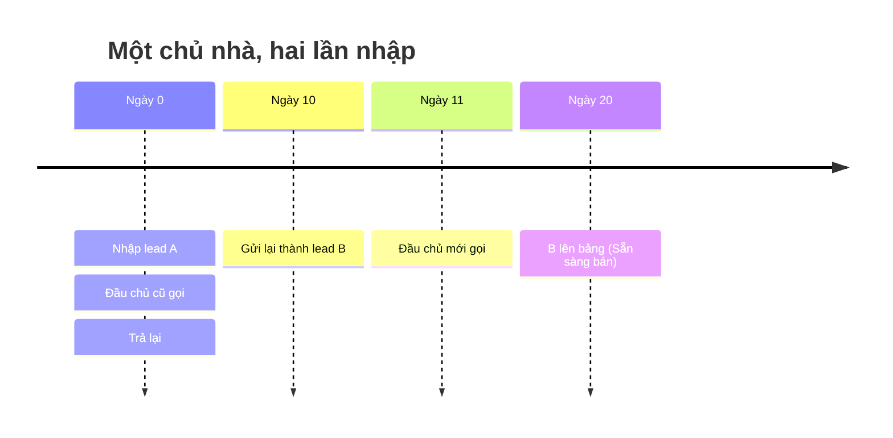

# Vá mốc gọi đầu của lead đã trả lại — thiết kế

Hàng `va-moc-goi-dau-lead-tra-lai` (T3, dãy B, migration giữ chỗ 023). Ô cơ hội ký `build` 02/11. Gộp thêm luật 37
(Ngoài-5 của hàng 52: một định nghĩa chung cho lead trả lại rồi gửi lại) và luật 40 (sửa gốc ca số đo chập chờn).

## Bài toán

1. `app.mark_first_call` (011) chỉ kiểm người giữ, `outcome`, `discarded_at` — không kiểm `returned_at`. Đầu chủ đã trả
   lead vẫn ghi được mốc gọi đầu (200), làm lệch luật chia và hạn của hàng 25.
2. Số đo lõi `lead_to_first_call`, `lead_to_ready` (`packages/core/src/metrics/lead.ts`) đếm lead trả lại và lead gửi
   lại như hai lead, và tính thời lượng của lead gửi lại từ lúc nhập chính nó; `app.lead_board_metric` (015) tính từ lúc
   nhập lead đầu chuỗi. Hai nơi cho hai con số cho cùng một chủ nhà.
3. Ca `leads-mine.test.ts` «số đo: ngày lead → Sẵn sàng bán trên bộ mẫu» đặt mốc bằng `Date()` của JS cách lúc ghi bảng
   ~20 ms; lệch đồng hồ Postgres thì thừa một hàng 0,0 ngày.

## Cách làm

- **Migration `023_va_moc_goi_dau.sql`**: `create or replace function app.mark_first_call(uuid)` cùng chữ ký, thân y 011
  cộng `and returned_at is null` trong điều kiện chọn. Lead đã trả lại → `P0002` «không có lead này của người gọi» → API
  404 (đã có ánh xạ ở `packages/api/src/routing/store.ts`), không cột nào đổi. Giữ `revoke … from public` và `grant
  execute … to quy_hang_app`. Không sửa 011, không bảng mới (luật cách ly không đổi).
- **Định nghĩa chuỗi gửi lại ở lõi** (`packages/core/src/metrics/lead.ts`): `LeadVao` mang thêm `resubmittedLeadId`.
  Xét tại mốc `den` của kỳ: lead đã gửi lại trước `den` không đếm riêng — nó nối vào lead nó trỏ tới; lead cuối chuỗi
  đếm một lần, kỳ và thời lượng tính từ `createdAt` của lead đầu chuỗi; các mốc (gọi đầu, lên bảng, trả lại, chia) lấy
  của lead cuối. Lead gửi lại sau `den` thì tại `den` chuỗi dừng ở nó (lead đã trả lại).
- **Hàm SQL giữ nguyên**: `app.lead_board_metric` đã đi ngược chuỗi và chỉ có lead cuối lên bảng (lead trả lại bị loại ở
  `lead_board_at_all`). Bài kiểm cơ sở dữ liệu nạp chuỗi qua API, đọc hàng lead, chạy `tinhSoDo` của lõi và hàm SQL trên
  cùng dữ liệu, so từng chuỗi.
- **Ca chập chờn**: `tu` lấy bằng `select clock_timestamp()` trên kết nối chủ.
- **Tham chiếu**: thêm một dòng §12 «lead đã trả lại không ghi gọi đầu được; số đo lõi đếm chuỗi gửi lại một lần từ lúc
  nhập đầu chuỗi».

## Không làm

- Không đổi giao diện (luật 31: vá ở máy chủ). Không đổi `app.lead_board_metric`, `lead_board_at_all`.
- Không đổi luật trả lại (đầu chủ vẫn trả được tới khi lên bảng, kể cả đã gọi — Hỏi-4 hàng 27).

## Ví dụ một chuỗi (luật 37 — cột «Khuyến nghị» là định nghĩa đã chốt)

| Số đo | Khuyến nghị | Lối khác 1 | Lối khác 2 (như hiện nay) |
|---|---|---|---|
| lead → cuộc gọi đầu | 0 ngày (cuộc gọi sớm nhất trong chuỗi) | 11 ngày (cuộc gọi của lead cuối) | A: chưa gọi/trả lại · B: 1 ngày — hai lead |
| lead → Sẵn sàng bán | 20 ngày (từ A) | 20 ngày | A: trả lại · B: 10 ngày — hai lead |
