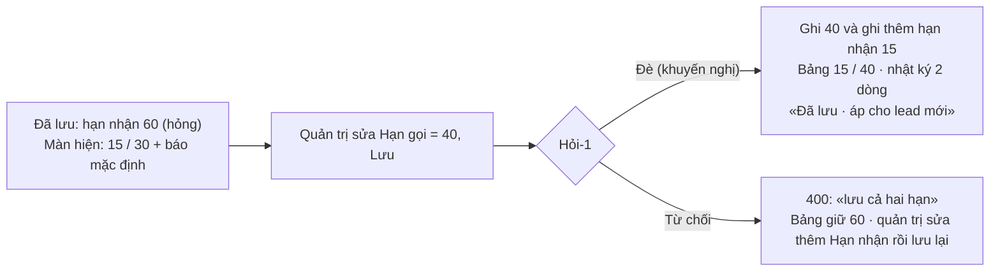

# Vá cặp hạn hỏng ở mục «Luật chia lead» — thiết kế

Hàng vá `luat-chia-lead-cap-han-hong` (dãy D, ngay sau hàng 48). Nguồn: Ngoài-2 và Ngoài-20 của hồ sơ `luat-chia-lead`;
chủ kho chọn «mở hợp đồng mới» ở Cổng Bằng chứng 06/11 (yêu cầu D-19).

## Lỗi

Hàng 82 chốt (Hỏi-1, chủ kho 04/11): sàn có dòng cặp hạn trái luật từ trước thì bộ giải đưa **cả cặp** về mặc định 15/30 và
GET cấu hình báo lỗi nêu hai khoá. Màn hàng 48 hiện đúng giá trị đang áp ấy (15/30) kèm báo «đang chạy theo mặc định».

Lối ghi `PATCH /api/v1/company/settings` (`packages/api/src/settings/store.ts`, `writeCompanySettings`) kiểm giá trị mới trên
cấu hình **đã giải** (cặp mặc định), nhưng chỉ ghi khoá vừa gửi. Hạn kia vẫn giữ giá trị hỏng cũ trong bảng:

- **Ngoài-2** — đã lưu hạn nhận 60 (hạn gọi chưa lưu, mặc định 30). Quản trị sửa hạn gọi thành 40: kiểm 40 ≥ 15 qua, ghi
  40; bảng còn 60/40 — vẫn trái luật, bộ giải lại về 15/30. Màn báo «Đã lưu · áp cho lead mới», lead mới vẫn 15/30.
- **Ngoài-20** — đã lưu hạn gọi 10 (hạn nhận mặc định 15). Quản trị sửa hạn nhận thành 5: kiểm 5 ≤ 30 qua, ghi 5; bảng
  còn 5/10 — hợp luật, nên hạn gọi 10 mà quản trị chưa từng thấy trên màn (màn hiện 30) bỗng có hiệu lực.

## Cách sửa

1. **Máy chủ ghi trọn cặp đã kiểm.** Trong `writeCompanySettings`, với mỗi khoá gửi lên thuộc một cặp `khongNhoHon` (sổ
   điểm), nếu khoá kia của cặp **không** có trong thân và giá trị đã lưu của nó khác giá trị đang áp (tức cặp đang hỏng,
   bộ giải đã đưa về mặc định), thì ghi thêm khoá kia bằng **giá trị đang áp** — đúng giá trị đã dùng để kiểm và đúng giá
   trị màn đang hiện. Sau lần lưu, bảng khớp cái quản trị thấy: Ngoài-2 thành 15/40, Ngoài-20 thành 5/30. Khoá ghi thêm đi
   cùng giao dịch và nhật ký như mọi khoá (một dòng sự kiện, người đổi, vai). Cặp không hỏng → không ghi thêm gì (nhật ký
   một dòng như cũ).
2. **Màn không báo «Đã lưu» khi phản hồi còn lỗi ở khoá vừa lưu.** Hàm thuần mới `ketQuaLuu(doi, ban)` ở
   `apps/web/src/app/(app)/settings/lead-routing/luat.ts`: phản hồi 200 mà `errors` còn nhắc một khoá trong số vừa đổi →
   báo lỗi trên đầu khung nêu tên dòng, không toast «Đã lưu». Đây là lưới thứ hai, phòng lối ghi khác (hay bản máy chủ cũ)
   còn để cặp hỏng.

Chiều 400 giữ nguyên: giá trị mới trái luật so với hạn kia đang hiện → 400 nêu khoá hạn gọi, không ghi gì.

## Phương án đã loại

- **Màn tự gửi cả hai hạn khi cặp đang hỏng.** Chỉ vá màn này; lối chung vẫn để cặp hỏng cho mọi bên gọi khác (Invest,
  công cụ sau). Kho đặt `packages/api` là đường ghi duy nhất (AGENTS.md) — sửa ở đó là sửa một chỗ.
- **Từ chối lưu một hạn khi cặp đang hỏng (bắt lưu cả hai).** Ép quản trị làm thêm một bước để sửa dữ liệu hỏng không do
  họ gây ra; giá trị đang áp đã có sẵn và hàng 82 đã chốt đó là giá trị đúng để chạy.

## Không làm

- Không dọn dòng hỏng lúc đọc (GET không ghi): đọc không đổi dữ liệu.
- Không đổi bộ giải hay luật cặp của lõi (hàng 82 đã chốt).
- Không đổi bố cục màn; không thêm dòng, nút hay trạng thái mới ngoài câu báo lỗi sau lưu.

## Đối chiếu ngành

Không áp: vòng không thêm đối tượng, danh sách hay điểm cấu hình nào — chỉ sửa cách lối ghi chung giữ một bất biến đã
chốt (cặp hạn ghi xuống luôn khớp cặp đã kiểm). Không có dòng «ta cứng — họ cấu hình».

## Hình — Hỏi-1: lưu một nửa của cặp đang hỏng

