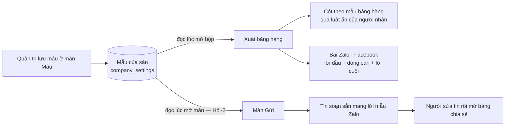

# Mẫu bảng hàng và mẫu bài theo kênh — thiết kế (hàng mau-bang-hang-va-bai)

Ngày 06/11/2026 · dãy L, đợt dau-khach-nhap · tách từ hàng 50 (Cổng Phạm vi 50, Hỏi-1) · Cổng Đáng đã ký ở hàng 50 (luật 74).

## 1. Việc

Quản trị sàn xem và sửa hai loại mẫu ở màn Mẫu của Cài đặt › Sàn:
- **mẫu bảng hàng** — điểm #26 `export.templates`: những cột nào, theo thứ tự nào, khi xuất bảng hàng;
- **mẫu bài theo kênh** — điểm #27 `share.post_templates`: lời mở đầu và lời kết của bài Zalo, bài Facebook.

Sửa hay xoá một mẫu thì lần xuất và lần gửi kế tiếp dùng bản mới; lần đã xong không đổi.

Sổ điểm biến thiên (`packages/core/src/config/so.ts`) đã khai cả hai điểm:
- kiểu `map`, không bảng riêng (`bang: null`);
- ai đổi: Quản trị sàn (`aiDoi: QT`);
- hiệu lực `lan_sau`;
- người được ghi đè lúc dùng: «Đầu chủ chọn mẫu khi phát» (#26), «Người gửi sửa bài trước khi chia sẻ» (#27).

## 2. Lưu ở đâu

- **Chỗ lưu.** Hai khoá trong `company_settings`, `data_class = company_internal`, đúng như sổ điểm khai. Không thêm migration:
  - cách ly theo dòng và nhật ký đổi đã có ở migration 026 (trigger ghi `company_settings_events`);
  - nếp lưu giống bộ nhãn riêng của hàng 45 (`packages/api/src/labels/store.ts`, khoá `labels.*`).
- **`export.templates`** là danh sách tối đa 20 mẫu. Mỗi mẫu có:
  - `id` (uuid);
  - `ten` (1–60 ký tự, không trùng trong sàn);
  - `cot`: 1–15 mã cột của bảng hàng, không trùng, chỉ cột có khoá ra (`COT_BANG_HANG[..].khoa ≠ null`).

  Cột nội bộ («Người giữ», «Giá chốt», «Ngày bán», «Lý do ngừng», «Ai thấy», «Mức đủ») không chọn được.
- **`share.post_templates`** là đối tượng theo kênh `zalo`, `facebook`. Mỗi kênh có `dau` và `cuoi`, mỗi phần 0–500 ký tự,
  chữ tự do của sàn, không mang biểu tượng cảm xúc (bài đã bỏ chúng từ hàng 43). Kênh vắng thì bài như hôm nay.
- **Kiểm khuôn.** Một hàm thuần ở `packages/core/src/export/mau-san.ts`, dùng cho cả API lẫn màn.
- **API.**
  - `GET /api/v1/company/templates/export` và `GET /api/v1/company/templates/posts`: mọi thành viên sàn đọc được, vì người xuất và người gửi cần mẫu.
  - `PUT` cùng đường: chỉ Quản trị ghi (403 với vai khác); 400 kèm lý do nêu khoá khi khuôn sai.
  - Ghi nguyên khối: sai một mẫu thì không mẫu nào được ghi.

## 3. Dùng ở đâu

- **Xuất bảng hàng** (hộp thoại hàng 43):
  - Bước «Mẫu» thêm ô «Cột theo»: «Góc nhìn đang mở» (mặc định, như hôm nay) hay một mẫu bảng hàng của sàn.
  - Chọn mẫu thì `xuatBang` nhận cột của mẫu thay cột góc nhìn, vẫn qua `cotRa` và `banRaNgoai` của người nhận (bất biến 4). Khách riêng: cột mã căn thành nấc tầng, như cũ.
  - Mẫu đọc lúc mở hộp thoại; đổi mẫu trong lúc hộp đang mở không làm đổi hộp ấy.
- **Bài Zalo, bài Facebook của Xuất bảng hàng:** `[dau] + phần dựng sẵn + [cuoi]`.
  - Phần dựng sẵn vẫn là `baiZalo`, `baiFacebook` (dòng tên sàn của Facebook giữ ở đầu).
  - Lời đầu, lời cuối là chữ của sàn, không đọc trường nào của căn.
- **Gửi (hàng 34)** — tin soạn sẵn:
  - Thứ tự: `chào` → `[dau Zalo]` → «Em gửi N căn…» → dòng căn → dòng link → `[cuoi Zalo]`.
  - Người gửi vẫn sửa tin trước khi bấm Gửi (ghi đè #27). Màn Gửi mở bảng chia sẻ của thiết bị, mặc định là Zalo, nên dùng mẫu kênh Zalo.
- **Lần đã xong không đổi:**
  - tệp đã tải nằm trên máy người dùng;
  - trang `/s/<mã>` của Lần gửi cũ không đọc mẫu;
  - tin đã gửi không lưu ở máy chủ.

  Chỉ lần xuất và lần mở màn Gửi sau khi đổi mới đọc bản mới.
- **Ngoài vòng:** trang nhóm môi giới (hàng 44) giữ cột cố định. Cho trang ấy theo một mẫu bảng hàng là việc sau (Hỏi-4).

### Mẫu chảy tới đâu

Lần đã xong (tệp đã tải, trang `/s/<mã>` cũ, tin đã gửi) không đọc mẫu — không có mũi tên nào tới chúng.

## 4. Màn Mẫu (Cài đặt › Sàn)

- Đổi nhãn mục «Mẫu nhập» thành «Mẫu», cùng đường `/settings/templates`, dựng trong khuôn `MucCaiDat` (nhóm `cai-dat-san`).
- Ba phần theo tab (Hỏi-3): «Mẫu nhập» (vùng của hàng 50, giữ nguyên) · «Mẫu bảng hàng» · «Mẫu bài».
- **Tab «Mẫu bảng hàng»:**
  - danh sách mẫu (tên, số cột, các cột theo thứ tự), nút «Thêm mẫu»;
  - mỗi mẫu sửa trong hộp gồm: ô tên, danh sách cột có thể ra ngoài kèm hộp chọn, nút lên/xuống để xếp thứ tự;
  - nút Xoá có hộp xác nhận.
- **Tab «Mẫu bài»:** hai khối Zalo, Facebook; mỗi khối có ô «Lời mở đầu», ô «Lời kết», xem trước với hai căn mẫu `[Tên]`, nút «Lưu» và «Về mặc định».
- **Quyền:** chỉ Quản trị mở màn; vai khác về Cá nhân kèm câu báo, như các mục sàn khác.

## Đặc tả UX

<!-- <<<UX-SPEC-TEMPLATE -->
## Đặc tả UX

### 1. Luồng

- Suôn sẻ: Cài đặt › Sàn › Mẫu → tab «Mẫu bảng hàng» → «Thêm mẫu» → đặt tên, chọn và xếp cột → Lưu → mẫu hiện trong danh sách; Đầu chủ mở Xuất bảng hàng → «Cột theo» chọn mẫu → xem trước đúng cột → tải hay chép (điểm ra: hộp thoại Xuất bảng hàng)
- Suôn sẻ (bài): tab «Mẫu bài» → khối Zalo → gõ lời mở đầu, lời kết → xem trước → Lưu; lần chép bài Zalo hay lần mở màn Gửi kế tiếp có hai lời ấy
- Biên: sàn chưa có mẫu bảng hàng nào (danh sách trống, «Cột theo» chỉ còn «Góc nhìn đang mở»); mẫu có cột người nhận không được thấy (khách riêng → cột ấy bị bỏ, dòng «Cột không ra ngoài»); quá 20 mẫu; vai không phải Quản trị
- Lỗi & quay lại: lưu bị từ chối (tên trùng, quá dài, không cột) → lý do dưới ô, hộp vẫn mở giữ chữ đã gõ; lỗi mạng khi lưu → câu báo, bấm lại; đọc mẫu lỗi ở hộp Xuất → «Cột theo» chỉ còn «Góc nhìn đang mở» kèm câu báo, xuất vẫn được

### 2. Kiểm kê màn

| Màn | MỘT việc của màn | Vào từ / ra tới |
|---|---|---|
| Cài đặt › Sàn › Mẫu | Quản trị giữ mẫu nhập, mẫu bảng hàng, mẫu bài của sàn | Menu Cài đặt sàn / ở lại |
| Hộp sửa mẫu bảng hàng | Đặt tên và chọn, xếp cột của một mẫu | Tab Mẫu bảng hàng / về danh sách |
| Xuất bảng hàng (hàng 43) | Chọn mẫu rồi tải hay chép bảng hàng | Bảng hàng / đóng hộp |
| Gửi (hàng 34) | Tin soạn sẵn mang lời của mẫu Zalo | Bảng hàng, Hồ sơ căn / bảng chia sẻ |

### 3. Bảng trạng thái

<!-- <<<UX-STATE-TABLE -->
| Trạng thái | Màn | Hiển thị gì | Người làm gì tiếp |
|---|---|---|---|
| ST-mau-dang-tai | Mẫu | «Đang tải mẫu…» | chờ |
| ST-mau-bang-trong | Mẫu (tab Mẫu bảng hàng) | «Sàn chưa có mẫu bảng hàng — xuất đang theo góc nhìn đang mở.» + nút «Thêm mẫu» | thêm mẫu |
| ST-mau-bang-co | Mẫu (tab Mẫu bảng hàng) | danh sách mẫu: tên, số cột, cột theo thứ tự | sửa, xoá, thêm |
| ST-mau-loi-doc | Mẫu | «Chưa đọc được mẫu — thử lại» | Thử lại |
| ST-mau-tu-choi | Hộp sửa mẫu | lý do dưới ô (vd «Tên đã có trong sàn») | sửa rồi lưu lại |
| ST-mau-loi-luu | Mẫu | «Chưa lưu được — thử lại» | lưu lại |
| ST-mau-da-luu | Mẫu | «Đã lưu mẫu» | tiếp tục |
| ST-mau-khong-quyen | (vai khác) | về Cá nhân, «Chỉ Quản trị sàn sửa được mẫu» | — |
| ST-xuat-mau-loi | Xuất bảng hàng | «Chưa đọc được mẫu của sàn — đang theo góc nhìn đang mở» | xuất theo góc nhìn |
<!-- UX-STATE-TABLE>>> -->

### 4. Hành vi

- Tên mẫu 1–60 ký tự, không trùng trong sàn (so sau khi bỏ khoảng trắng đầu cuối, không phân biệt hoa thường); 1–15 cột; tối đa 20 mẫu
- Lời mở đầu, lời kết 0–500 ký tự mỗi ô; đếm ký tự hiện dưới ô; biểu tượng cảm xúc bị bỏ khi dựng bài (như hàng 43)
- Xếp cột bằng nút lên/xuống (bàn phím dùng được), không kéo thả
- Máy tính trước; trên điện thoại màn vẫn dùng được (một cột)

### 5. Xuất xứ component

| Component | Nấc (dùng / ghép / mở rộng / tạo) | Vì sao (1 dòng) |
|---|---|---|
| `MucCaiDat` (khuôn cai-dat-san) | dùng | khuôn của mọi mục Cài đặt › Sàn |
| Tabs (shadcn) | dùng | ba phần của một màn |
| Dialog, Checkbox, Button, Field (shadcn) | ghép | hộp sửa mẫu bảng hàng như hộp sửa cột của hàng 50 |
| `TrangThai` | dùng | mọi trạng thái trống, lỗi, báo |
| Select của hộp Xuất (hàng 43) | mở rộng | thêm ô «Cột theo» trong bước Mẫu |

### 6. Khuôn IA đã chọn + căn cứ

Khuôn IA: danh-sách-chi-tiết (master-detail)
Căn cứ: luồng hiển nhiên, cùng khuôn với màn Mẫu nhập của hàng 50: danh sách mẫu, mở một mẫu trong hộp để sửa. Không tra thêm.

### 7. Thẻ việc

| Trường | Giá trị |
|---|---|
| Ai dùng | Quản trị sàn |
| Việc chính | Đặt sẵn cột của bảng hàng khi xuất và lời đầu, lời cuối của bài cho cả sàn |
| Tần suất | hiếm |
| Số bản ghi | vài chục |
| Thiết bị | máy tính |
<!-- UX-SPEC-TEMPLATE>>> -->

## 5. Câu hỏi cho chủ kho (Cổng Phạm vi)

- **Hỏi-1 · Hình của mẫu bài.**
  - Khuyến nghị: lời mở đầu và lời kết tự do quanh phần máy dựng sẵn từ bản đã ẩn. Sàn không chèn được trường nào của căn, nên không có đường rò.
  - Lối khác: mẫu có chỗ trống (`{gia}`, `{toa}`…) để sàn tự xếp từng dòng căn. Linh hoạt hơn, nhưng phải dựng bộ đọc chỗ trống và luật ẩn cho từng chỗ trống — thêm 2–3 tiêu chí.
- **Hỏi-2 · Mẫu Zalo có áp cho tin của màn Gửi không.**
  - Khuyến nghị: có, vì câu giao nói «lần gửi kế dùng bản mới». Lời đầu, lời cuối chèn quanh tin soạn sẵn; người gửi vẫn sửa được.
  - Lối khác: chỉ áp cho bài chép ở Xuất bảng hàng. Ít tiêu chí hơn, nhưng màn Gửi vẫn chưa theo mẫu của sàn.
- **Hỏi-3 · Một màn «Mẫu» ba tab.**
  - Khuyến nghị: đổi nhãn mục «Mẫu nhập» thành «Mẫu», ba tab trong một màn — đúng chữ «màn Mẫu» của câu giao.
  - Lối khác: thêm hai mục riêng «Mẫu bảng hàng», «Mẫu bài» ở menu Cài đặt › Sàn. Menu dài hơn, mỗi mục một màn.
- **Hỏi-4 · Trang nhóm môi giới (hàng 44) có theo mẫu bảng hàng không.**
  - Khuyến nghị: chưa — vòng này để trang ấy giữ cột cố định, việc nối là một hàng sau.
  - Lối khác: thêm ô «mẫu cho trang môi giới» ở mục Trang môi giới — thêm 1–2 tiêu chí và chạm vùng hàng 44 vừa gộp.
- **Hỏi-5 · Duyệt giao diện.**
  - Khuyến nghị: duyệt bằng chữ ở đây, nhìn màn thật ở Cổng Bằng chứng — như hàng 50 và hàng 44 chủ kho đã chọn.
  - Lối khác: dựng bản bấm được dưới `/settings/templates/mau` trước khi duyệt — thêm một lượt chờ.

- **Hỏi-6 · Cấp của mẫu.**
  - Khuyến nghị: mẫu chỉ ở cấp sàn. Người dùng chọn mẫu và sửa tin lúc dùng. Quỹ hàng chưa có khái niệm «Nhóm» (Tham chiếu §6).
  - Lối khác: thêm mẫu theo nhóm hay theo người, như ba cấp của BoldTrail. Cần khái niệm Nhóm trước; thêm vài tiêu chí.
- **Hỏi-7 · Ghi mẫu đã dùng vào sổ xuất.**
  - Khuyến nghị: chưa ghi. Sổ `exports` giữ như hiện tại. Ghi thêm phải đổi bảng bằng migration, tức là lên hạng T3.
  - Lối khác: thêm cột «mẫu» vào sổ `exports` để Quản trị biết lần xuất cũ theo mẫu nào — thêm migration và 1 tiêu chí.

## 6. Đối chiếu ngành (ADR-0022)

| Năng lực | RESO | Follow Up Boss | BoldTrail | Ta định làm | Ta cứng — họ cấu hình |
|---|---|---|---|---|---|
| Cột của bảng gửi đi | Không có đối tượng «mẫu xuất»; cột mang tên trường RESO (`UnitNumber`, `ListPrice`, `LivingArea`…) | không có xuất bảng hàng (chưa kiểm) | gửi listing đã chọn qua email hay tin nhắn, khuôn thư của hãng ([Email Listings](https://help.insiderealestate.com/en/articles/3424538-boldtrail-how-to-email-listings-to-your-contacts)); chọn cột: chưa kiểm | Sàn đặt nhiều mẫu cột; người xuất chọn mẫu hay góc nhìn | Không — cột là dữ liệu của sàn |
| Bài soạn sẵn để chép | — | bài mẫu để chép, quản theo tài khoản ([Text Template Scripts](https://help.followupboss.com/hc/en-us/articles/4403022689303-Text-Template-Scripts)); biến chèn tên khách: chưa kiểm | khuôn thư listing: chưa kiểm | Sàn đặt lời mở đầu, lời kết theo kênh; dòng căn do lõi dựng từ bản đã ẩn | Dòng căn cố định ở lõi — họ có thể cho chèn biến (chưa kiểm) → **Hỏi-1** |
| Ai đặt mẫu | — | chủ tài khoản quản ([Users, Roles & Permissions](https://help.followupboss.com/hc/en-us/articles/4402370636567-Users-Roles-Permissions)) | ba cấp Công ty ⊃ Văn phòng ⊃ Đội ([Defining User Roles](https://help.insiderealestate.com/en/articles/4336931-boldtrail-defining-user-roles)) | Quản trị sàn đặt; người dùng chọn mẫu và sửa tin lúc dùng (ghi đè #26, #27) | Chưa có cấp nhóm hay người → **Hỏi-6** |

Giữ cứng dòng căn của bài có lý do «quyền và an toàn» (bất biến 4: dữ liệu ra ngoài dựng từ luật ẩn ở lõi). Hỏi-1 trình lại cho chủ kho chọn.
