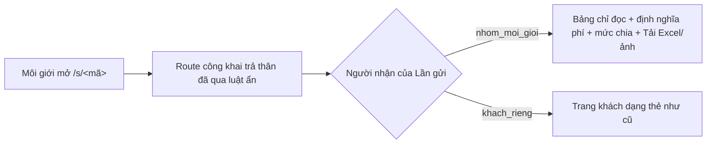

# Trang nhóm môi giới (hàng 44) — thiết kế

Ngày: 06/11. Hồ sơ: `_acceptance/trang-nhom-moi-gioi/`. Ô cơ hội: Cổng Đáng đã ký «build» (05/11).

## Mục tiêu

Môi giới sàn khác mở link bảng hàng, không cần đăng nhập, và thấy đủ ba thứ: mã căn, phí gọi theo tên chuẩn kèm định nghĩa
của sàn, và mức chia của bộ. Sàn ẩn mức chia thì mức chia không hiện. Môi giới tải được Excel hay ảnh bảng hàng với đúng các
cột ấy. Không số chủ nhà, giá đáy hay ghi chú nội bộ nào lọt ra, vì mọi thứ dựng từ luật ẩn ở lõi (bất biến 4).
Đã chốt 29/10 ở Tham chiếu §12: mức chia lấy mặc định của sàn, người gửi sửa theo bộ, sàn ẩn được. Tham chiếu dòng 270: màn
P1, nhóm T4, máy tính.

## Hiện trạng

- Lần gửi đã có người nhận `agents`. Lõi đổi kiểu người nhận này thành `nhom_moi_gioi` (`packages/core/src/sharing/trang-khach.ts:14`).
  Luật ẩn cho người nhận này ra đủ mã căn (`packages/core/src/redaction/ban-ra.ts:114`).
- Link `/s/<mã>` dựng cùng một trang dạng lưới thẻ cho điện thoại, dùng chung cho cả khách riêng lẫn nhóm môi giới. Hiện
  chưa có lối hiện riêng cho môi giới.
- Hai điểm cấu hình #15 `broker_page.commission_split_pct` và #16 `broker_page.hide_commission_split` đã có trong sổ
  (`packages/core/src/config/so.ts:99-100`, `man: "44"`) nhưng chưa ai đọc. Bảng `shares` chưa có cột mức chia.
- Cột của bảng hàng ra ngoài: `COT_BANG_HANG` / `cotRa` (`packages/core/src/export/cot.ts`). Excel ghi bằng `ghiXlsx` của
  lõi. Ảnh vẽ bằng canvas ở `apps/web/src/app/(app)/inventory/phat-hang/ve-anh.ts`.
- Điều kiện phí: khoá ra `feeInclusion` (included / excluded). Định nghĩa của sàn là điểm #8 `fee.inclusion` (tập con của
  thuế TNCN, lệ phí trước bạ, phí môi giới), hiện chưa ra ngoài.

## Phương án

1. **Một link, hai cách hiện.** `/s/<mã>` đọc thân trang qua route công khai như hiện nay. Thân có người nhận
   `nhom_moi_gioi` thì trang dựng bảng môi giới, mọi thành phần của bảng nằm ở `apps/web/src/app/s/broker/`. Thư mục này
   không có `page.tsx`, nên không sinh route mới. Link đã gửi cho nhóm môi giới mở được ngay, luồng Gửi không phải đổi
   đường dẫn. Đã loại lối tách route riêng `/s/broker/<mã>`, vì link đã gửi sẽ hỏng và phải sửa nơi sinh link.
2. **Thân trang môi giới dựng ở lõi.** Mở rộng `thanTrangKhach` (hoặc thêm `thanTrangMoiGioi` cạnh nó) để thêm ba khoá, và
   chỉ thêm khi người nhận là `nhom_moi_gioi`:
   - `cot`: danh sách cột ra, lấy từ `cotRa` với người nhận nhóm môi giới. Bảng trang, Excel và ảnh cùng đọc danh sách này,
     để «đúng những cột ấy» là một nguồn.
   - `dinhNghiaPhi`: tên chuẩn theo cách gọi riêng của sàn, kèm các khoản sàn tính vào «Bao phí». Tập khoản chụp vào Lần
     gửi lúc gửi (điểm #8 khai hiệu lực «mới»); Lần gửi trước 048 không có bản chụp thì đọc `fee.inclusion` hiện tại.
   - `mucChia`: mức chia của Lần gửi. Khoá này vắng hẳn khi sàn bật `broker_page.hide_commission_split` hoặc bộ không có
     mức. Lõi quyết chuyện vắng, giao diện không tự ẩn.
   Route công khai đọc cấu hình sàn gửi trong phiên của người gửi, như cách đang đọc cách gọi riêng.
3. **Mức chia và định nghĩa phí lưu trên Lần gửi.** Migration 048 chỉ thêm cột `fee_inclusion text[] null` (chỉ nhận khoản
   của tập đóng #8) và cột `commission_split_pct numeric(5,2) null` vào `shares`; mức chia kèm hai
   ràng buộc: giá trị trong khoảng 0–100, và khách riêng thì cột rỗng. `app.create_share` thêm tham số mức chia. Hiệu lực
   «mới» (sổ điểm #15): bộ mang mức lúc gửi, sàn đổi mặc định về sau thì bộ đã gửi không đổi. Số 048 do giám sát cấp.
4. **Người gửi sửa theo bộ.** Ở luồng Gửi, khi người nhận là nhóm môi giới, có ô «Mức chia (%)» điền sẵn mặc định của sàn.
   Người gửi sửa hay xoá trống được. Gửi cho khách riêng thì không có ô này.
5. **Sàn đặt mặc định và ẩn.** Mục mới «Trang môi giới» trong Cài đặt › Sàn (khuôn `MucCaiDat`, chỉ Quản trị sàn) đặt
   mức chia mặc định (0–100, để trống được) và công tắc «Ẩn mức chia». Mục lưu qua đường chung
   `PATCH /api/v1/company/settings` (hàng 82).
6. **Tải Excel và ảnh trên máy người mở.** Hai nút trên trang môi giới dựng tệp từ chính thân trang đã qua luật ẩn:
   - Excel qua `ghiXlsx` của lõi.
   - Ảnh PNG qua bộ vẽ canvas của Xuất bảng hàng.
   Dòng đầu tệp ghi tên sàn, định nghĩa phí và mức chia (khi không ẩn). Không gọi route mới, nên không thêm cửa ra phía máy chủ.

## Đối chiếu ngành (ADR-0022)

| Năng lực | RESO | Sản phẩm khác | Ta định làm | Ta cứng — họ cấu hình |
|---|---|---|---|---|
| Mức chia cho môi giới bên kia | `BuyerAgencyCompensation` + `BuyerAgencyCompensationType` (Property) | Flexmls, Matrix hiện hoa hồng hợp tác cho thành viên MLS, không cho khách (**chưa kiểm**) | Mặc định của sàn, người gửi sửa theo bộ, sàn ẩn được (#15, #16) | Đơn vị: ta chỉ nhận %. RESO có kiểu (%, số tiền, xem ghi chú) → Hỏi-1 |
| Cột của bảng gửi môi giới | không có | Matrix cho mỗi người chọn bộ cột hiển thị (**chưa kiểm**) | Cột ra của Xuất bảng hàng cho nhóm môi giới (`cotRa`) | Ta cứng tới hàng mẫu bảng hàng (#26) → Hỏi-2 |
| Định nghĩa phí | không có | không có tương ứng ở MLS Mỹ (**chưa kiểm**) | Tên chuẩn theo cách gọi của sàn + các khoản của `fee.inclusion` | Đã là dữ liệu của sàn |
| Tải bảng về máy | không có | Flexmls, Matrix cho xuất CSV hay PDF với thành viên (**chưa kiểm**) | Excel và ảnh dựng từ bản ra của luật ẩn | Không có chỗ cứng |

## Đặc tả UX

<!-- <<<UX-SPEC-TEMPLATE -->
## Đặc tả UX

### 1. Luồng

- Suôn sẻ: môi giới nhận link qua Zalo → mở trên máy tính → thấy đầu trang (sàn, người gửi, định nghĩa phí, mức chia) và
  bảng căn chỉ đọc → bấm «Tải Excel» hoặc «Tải ảnh» (điểm ra: tệp trên máy).
- Biên: sàn ẩn mức chia hoặc bộ không có mức → không có dòng mức chia. Căn đã cọc hay đã bán → dòng mờ, giá ẩn như luật ẩn.
  Mở trên điện thoại → bảng cuộn ngang.
- Lỗi & quay lại: link tắt hay sai mã → «Link không còn mở» như trang khách. Lỗi tạm khi đọc → «Chưa tải được — thử lại».
  Tải tệp lỗi → báo tại nút, bảng vẫn đọc được.

### 2. Kiểm kê màn

| Màn | MỘT việc của màn | Vào từ / ra tới |
|---|---|---|
| Trang nhóm môi giới `/s/<mã>` | Đọc và tải bộ căn sàn khác gửi | Link Zalo / tệp Excel hay ảnh |
| Cài đặt › Sàn › Trang môi giới | Đặt mức chia mặc định và ẩn | Cột Cài đặt sàn / ở lại mục |
| Gửi (ô Mức chia) | Sửa mức chia của bộ trước khi gửi | Bảng hàng thẻ / bảng chia sẻ |

### 3. Bảng trạng thái

<!-- <<<UX-STATE-TABLE -->
| Trạng thái | Màn | Hiển thị gì | Người làm gì tiếp |
|---|---|---|---|
| ST-moigioi-loading | Trang môi giới | Khung bảng mờ (skeleton) | Chờ |
| ST-moigioi-data | Trang môi giới | Đầu trang + bảng mọi căn theo thứ tự gửi + hai nút tải | Đọc, tải |
| ST-moigioi-an-chia | Trang môi giới | Như trên, không dòng mức chia | Đọc, tải |
| ST-moigioi-tat | Trang môi giới | «Link không còn mở» | Hỏi người gửi |
| ST-moigioi-loi | Trang môi giới | «Chưa tải được — thử lại» | Thử lại |
| ST-moigioi-tai-loi | Trang môi giới | Câu báo tại nút tải | Thử lại |
| ST-caidat-data | Trang môi giới (cài đặt) | Ô mức chia + công tắc ẩn + Lưu | Sửa, lưu |
| ST-caidat-tu-choi | Trang môi giới (cài đặt) | Lý do dưới ô (ngoài 0–100) | Sửa lại |
| ST-caidat-khong-quyen | Trang môi giới (cài đặt) | Chuyển về Cá nhân kèm câu báo | — |
<!-- UX-STATE-TABLE>>> -->

### 4. Hành vi

- Ô mức chia nhận số thập phân trong khoảng 0–100, để trống được. Ngoài khoảng thì máy chủ trả 400, kèm lý do hiện dưới ô.
- Bảng chỉ đọc: không sửa, không chọn dòng. Sắp theo thứ tự gửi. Máy tính hiện tràn rộng; điện thoại cuộn ngang.

### 5. Xuất xứ component

| Component | Nấc (dùng / ghép / mở rộng / tạo) | Vì sao (1 dòng) |
|---|---|---|
| Lưới của Bảng hàng ở chế độ chỉ đọc (`data-grid-virtualization-1`) | dùng | vo-va-ia.md:142 chỉ định |
| `KhungTrangKhach` | dùng | khuôn trang-khach bắt mọi trang dưới `/s/` |
| `MucCaiDat` | dùng | khuôn cai-dat-san |
| `ghiXlsx`, bộ vẽ ảnh của Xuất bảng hàng | dùng | cùng nguồn cột với Xuất bảng hàng |

### 6. Khuôn IA đã chọn + căn cứ

Khuôn IA: một-cột-cuộn
Căn cứ: trang chỉ có một việc là đọc rồi tải một bộ ≤ 30 căn, nên không cần chi tiết hay điều hướng; vo-va-ia.md:142 chỉ định
dùng lưới Bảng hàng ở chế độ chỉ đọc.

### 7. Thẻ việc

| Trường | Giá trị |
|---|---|
| Ai dùng | Môi giới sàn khác |
| Việc chính | Đọc bộ căn được gửi và tải về để đăng lại cho khách của mình |
| Tần suất | mỗi ngày |
| Số bản ghi | vài chục |
| Thiết bị | máy tính |
<!-- UX-SPEC-TEMPLATE>>> -->

## Ngoài phạm vi

- Đếm lượt tải Excel hay ảnh làm số đo. Lượt mở link đã có từ hàng 35.
- Lối hiện riêng cho điện thoại (bảng chỉ cuộn ngang).
- Mẫu bảng hàng do sàn tự chỉnh cột (điểm #26, hàng mau-bang-hang-va-bai).
- Link tự hết hạn.

## Luồng một link (Hỏi-5)

